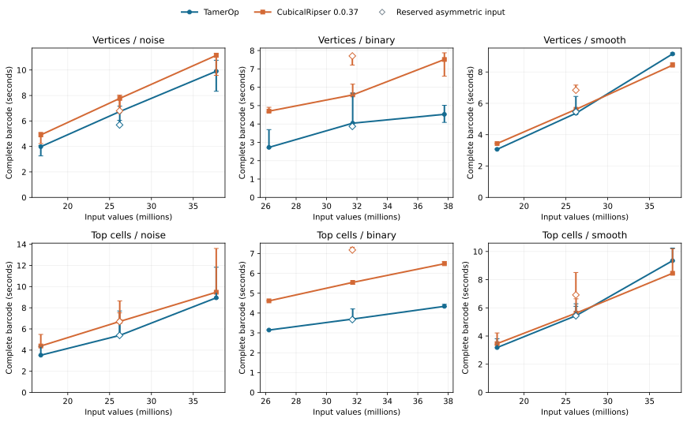
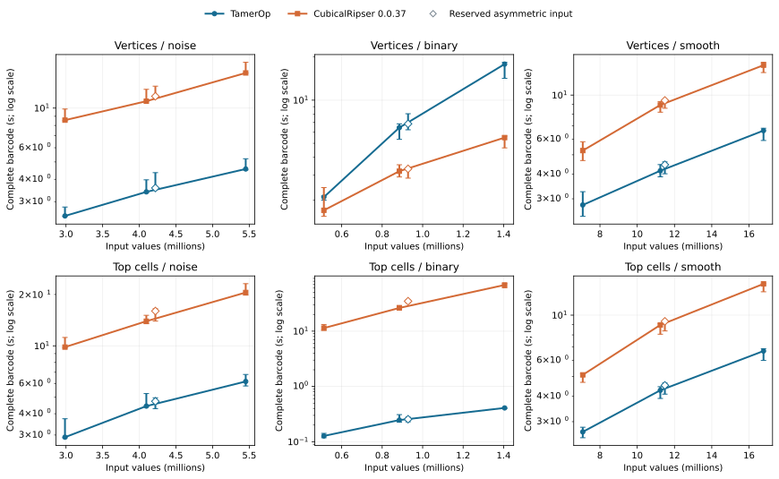

# Cubical barcodes: TamerOp and CubicalRipser

**Official comparison v1, 11 October 2026.** This study measures complete
ordinary F₂ barcodes from large 2D and 3D scalar arrays. These dimensions
refer to the spatial arrays; every request has one persistence parameter. The geometric mean of the paired speed ratios is **2.18×** across the fixed 48 requests (CubicalRipser time divided by TamerOp time).
The family tables below show where that aggregate holds and where it does not.

TamerOp's strongest results are on noisy and smooth 3D volumes and binary
top-cell volumes. At `176³`, noisy vertex input takes **4.57 s versus 15.7 s**;
at `256³`, smooth top-cell input takes **6.67 s versus 14.2 s**.
Most 2D differences are smaller, with several smooth cases performing similarly.

Binary vertex input is the substantial exception. At `112³`, it takes
**17.9 s versus 5.48 s**, favoring CubicalRipser. The opposite convention
behaves very differently: binary top-cell input at `112³` takes
**0.409 s versus 68.4 s**. Those large top-cell ratios strongly influence
the aggregate. This is evidence for a useful but workload-dependent advantage,
not a general guarantee that one program is faster on every image or volume.

All **48 requests** completed with exactly matching interval multisets across
**864 accepted samples**. The implementation was frozen before sizing and final
confirmation. The primary timer measures compiled code doing fresh mathematics,
from an already loaded Float64 array to a materialized native result.

[All comparisons](index.md) · [Times and sizes](#times-and-sizes) ·
[Machine](#machine-and-builds) · [Full results and data](cubicalripser_v1/README.md)

## What is being compared?

A scalar image or volume determines a growing cubical complex. Vertex input
(**V**) gives each cell the largest value at its vertices. Top-cell input
(**T**) gives a face the smallest value of its incident top cells. The two
conventions describe different filtrations, so each has its own comparisons.
The answer is every positive-length and essential interval through H₁ in 2D
or H₂ in 3D, including multiplicities.

TamerOp uses its direct ordinary-persistence route. These requests ask for the
complete barcode; they do not ask either tool to retain a finite encoded module,
structure maps, source chains or representative cocycles. Finite encodings
remain the common object for TamerOp's broader algebraic workflows.

The competitor is the unchanged **CubicalRipser 0.0.37** Release build, called
through its supported `cripser.compute_ph` array interface. This is the cubical
software, distinct from both [Ripser.py](ripser.md) and [C++ Ripser](ripser_cpp.md),
which were compared on Rips filtrations. CubicalRipser's native birth/death
coordinate columns are unavoidable extra output in this call and are charged
inside its timer; they are not a matched representative-cycle request.

## Inputs and measurement

The suite has four lanes—2D/3D, each V/T—and three structures: eight-level random
noise, two-level random binary arrays, and an integer-rounded radial quadratic
field. Every stratum has three fixed sizes and one reserved asymmetric input.
The 12 reserved arrays use separate seeds, and the binary/smooth reserved cases
use superlevels. Their shapes and seeds were fixed before they were generated.
This is a synthetic integer-grade suite with many ties, not a survey of natural
images or arbitrary floating-point scalar fields.

The generator uses NumPy PCG64 with UInt16 draws in blocks of 1,048,576. Noise
values are 0–7; binary values are 0 and 4. At zero-based coordinate `i`, the
smooth value is `sum((2*i[j] - (shape[j]-1))^2) // maximum(shape)`. Arrays are
generated in column-major order, stored losslessly, then converted to Float64
before timing. The manifest records every shape, seed, generator version and
input hash.

Sizing used absolute runtimes and resource feasibility. The reported case
medians span **0.127–17.9 seconds** in
TamerOp and **1.7–68.4
seconds** in CubicalRipser. Most queries take seconds, as intended. Binary
top-cell volumes are the exception: TamerOp finishes in under a second while
CubicalRipser takes tens of seconds. Raising those sizes until both tools took
seconds would exceed the campaign's practical limits. Calibration results are
separate from confirmation.

Each request/tool has three fresh-process passes and three accepted samples per
pass. A separate shifted array warms the same public route, then all warmup
results are discarded. Measured calls retain only the supplied input and
input-independent package data; grid topology, reductions and barcode results
are recomputed. Every accepted Julia sample has zero measured compilation and
recompilation. Tool order alternates by case and pass.

Lossless input decompression, input hashing, barcode canonicalization and result
writing are outside the timer. Native construction, conversions required by the
public call, superlevel negation and complete native output creation are inside.
Both tools receive the same column-major Float64 values. Exact histogram
comparison verifies every interval and its multiplicity without writing millions
of duplicate JSON rows.

## Times and sizes

Times are medians of three process medians, in seconds. Ratios are geometric
means of paired process ratios; they need not equal the quotient of the displayed
times. Parentheses give the minimum and maximum process ratios, not confidence
intervals. Ratios above one favor TamerOp. The predeclared symmetric practical
band is 1/1.10–1.10; results in that band are described as similar performance.

The table shows the largest of the three regular sizes in each stratum. All 48
requests, including the reserved inputs, appear in the [full CSV](cubicalripser_v1/results.csv)
and [structured results](cubicalripser_v1/analysis.json).

| Input | Array shape | Intervals | TamerOp (s) | CubicalRipser (s) | CubicalRipser / TamerOp (range) |
| :--- | :--- | ---: | ---: | ---: | ---: |
| 2D V / noise | 6144 × 6144 | 9,996,782 | 9.9 | 11.1 | 1.11 (1.05–1.15) |
| 2D T / noise | 6144 × 6144 | 9,995,039 | 8.94 | 9.47 | 1.09 (1.06–1.15) |
| 2D V / binary | 6144 × 6144 | 2,608,645 | 4.53 | 7.51 | 1.61 (1.57–1.66) |
| 2D T / binary | 6144 × 6144 | 2,605,386 | 4.34 | 6.49 | 1.49 (1.49–1.5) |
| 2D V / smooth | 6144 × 6144 | 1 | 9.15 | 8.43 | 0.927 (0.915–0.939) |
| 2D T / smooth | 6144 × 6144 | 1 | 9.34 | 8.45 | 0.933 (0.901–0.995) |
| 3D V / noise | 176 × 176 × 176 | 1,489,353 | 4.57 | 15.7 | 3.46 (3.44–3.48) |
| 3D T / noise | 176 × 176 × 176 | 1,462,002 | 6.18 | 20.5 | 3.38 (3.32–3.41) |
| 3D V / binary | 112 × 112 × 112 | 115,108 | 17.9 | 5.48 | 0.313 (0.298–0.327) |
| 3D T / binary | 112 × 112 × 112 | 116,337 | 0.409 | 68.4 | 165 (154–177) |
| 3D V / smooth | 256 × 256 × 256 | 1 | 6.62 | 14.2 | 2.16 (2.14–2.2) |
| 3D T / smooth | 256 × 256 × 256 | 1 | 6.67 | 14.2 | 2.13 (2.08–2.17) |

[Open the 2D figure](cubicalripser_v1/runtime_2d.svg) ·
[Open the 3D figure](cubicalripser_v1/runtime_3d.svg)

Lines join the three regular sizes within a family; they guide the eye rather
than fit a scaling law. Open diamonds show reserved asymmetric inputs. Vertical
bars show the range of process medians, not statistical confidence intervals.
The 2D panels use linear time axes; the 3D panels use logarithmic time axes to
keep both subsecond and much slower calls readable.

## Larger binary calibration and size limits

Binary volumes exposed a substantial cost that the earlier small noisy/smooth
controls did not reveal. The initial 160³ sizing calls are retained below,
separately from the scored confirmation population. CubicalRipser timed out during
the top-cell warmup, so that case has no cross-tool verification or measured speed
ratio. The vertex calibration returned matching barcodes. These are single calibration
samples, not three-pass estimates. A smaller binary ladder was then calibrated
to keep the main campaign within its declared duration. Neither implementation
was changed. The smaller confirmation sizes do not erase these larger results.

| Initial calibration | TamerOp (s) | CubicalRipser (s) |
| :--- | ---: | ---: |
| 160³ V / binary | 113 | 14.6 |
| 160³ T / binary | 1.31 | No completed query; 180 s warmup limit |

[All calibration records](cubicalripser_v1/calibration.json) include successful
calls, warmups and resource/time limits. Strong claims about scaling beyond the
confirmed size ladders are not supported by this study.

## Results by family

Each row gives the geometric mean of four case ratios. The whole-suite summary
weights the 12 strata equally, with four equally weighted requests per stratum.
It is a statement about this fixed suite, not an estimate over all scalar fields.

| Family | Verified requests | CubicalRipser / TamerOp |
| :--- | ---: | ---: |
| 2D V / noise | 4/4 | 1.19 |
| 2D V / binary | 4/4 | 1.59 |
| 2D V / smooth | 4/4 | 1.07 |
| 2D T / noise | 4/4 | 1.19 |
| 2D T / binary | 4/4 | 1.58 |
| 2D T / smooth | 4/4 | 1.09 |
| 3D V / noise | 4/4 | 3.33 |
| 3D V / binary | 4/4 | 0.507 |
| 3D V / smooth | 4/4 | 2.05 |
| 3D T / noise | 4/4 | 3.24 |
| 3D T / binary | 4/4 | 121 |
| 3D T / smooth | 4/4 | 2.02 |

## Startup and memory

Median package-import time was **2.33 s** for
TamerOp and **0.0771 s** for NumPy/CubicalRipser.
The Julia import timer starts after the harness has loaded SHA, JSON3 and
LinearAlgebra; the Python timer includes NumPy. These are diagnostic load
measurements, not a matched cold-start comparison. They exclude process launch
and the later compilation-bearing
warmup. Warmup times and Julia compilation counters are in the downloadable
samples and per-process records. They are not part of the compiled-query ratios.

The table gives observed ranges across each lane. Process RSS includes runtime,
compiled code, inputs, temporary storage, warmup and untimed verification; it is
not retained mathematical storage. Retained-result sizes describe the returned
Julia object or NumPy array plus wrapper, using each runtime's object accounting.
CubicalRipser's coordinate columns are included. Julia allocation traffic is
recorded separately; no comparable C++ allocation-traffic claim is made.

| Lane | TamerOp peak RSS (GiB) | CubicalRipser peak RSS (GiB) | TamerOp result (MiB) | CubicalRipser result (MiB) |
| :--- | ---: | ---: | ---: | ---: |
| 2D V | 2.26–3.85 | 3.28–7.38 | 0.000465–189 | 0.000191–686 |
| 2D T | 2.25–3.91 | 3.16–7.1 | 0.000465–189 | 0.000191–686 |
| 3D V | 1.2–3.91 | 0.277–2.4 | 0.000542–31 | 0.000191–102 |
| 3D T | 1.15–3.96 | 0.664–3.01 | 0.000542–31 | 0.000191–100 |

Both tools had an 8 GiB observed process-RSS cap, a 180-second phase limit,
a 30-minute worker limit and a four-hour formal campaign budget. The supervisor
was also configured to stop its own worker if system available memory fell below 2 GiB.
No formal worker reached a time or memory limit.
TamerOp used a 128 GiB *construction-estimate allowance*, because its general
complex estimate is much larger than the direct grid algorithm's actual storage.
That allowance is not an allocation and does not relax the common RSS cap.

## Correctness and scope limits

The new release passed 54 of 56 independent ordinary-barcode controls. Both
failures were vertex arrays shaped 1×3: CubicalRipser returned three essential
components instead of the oracle's one, in both sublevel and superlevel order.
The timed suite has no singleton axes; all independent controls for its lanes
passed. This restriction was recorded before formal timing, and the failures
remain in the [qualification data](cubicalripser_v1/qualification.json).

Twelve further small controls independently checked the compressed-input harness
across both dimensions, V/T conventions and all three structures. Negative tests
check malformed grades, multiplicities and corrupted protocol evidence. Every
formal result then matched exactly across tools, samples and process passes.
These checks provide evidence of correctness, not a proof for all inputs.

Optional contracts were examined separately. Twelve of 24 representative controls
passed the stronger interval-generator lifetime check; the others did not establish
that their returned cycle dies with the associated interval. A valid cycle at
birth can be a birth-component witness without satisfying that stronger contract;
these failures do not show an incorrect barcode. All four top-degree
shortcut controls passed in 0.0.37. Neither optional path changes this study's
complete-barcode request. Periodic boundaries, other fields, representative
outputs, singleton axes, 1D/4D arrays and real application datasets are outside
the timed scope.

## Machine and builds

| Item | Configuration |
| :--- | :--- |
| CPU | Intel Core i7-1365U, 12 logical CPUs |
| RAM | Approximately 31 GiB physical RAM |
| OS | Linux Mint 21.3, x86-64; kernel 6.8.0-138-generic |
| C++ compiler | GCC 11.4.0 |
| CPU frequency policy | `powersave`; fixed logical CPU 0, no fixed-frequency claim |
| Execution | Serial workers, pinned to one logical CPU; one numerical thread |
| Julia | 1.12.1, existing package images, 3 GiB GC heap hint |
| TamerOp | Frozen 11 October development snapshot; Project.toml still labels it 0.1.0 |
| Source identity | `404f8b0d949bbe98778185600954e28002d7b286e2aab57f9e0c7cea72d309a6` |
| CubicalRipser | PyPI cripser 0.0.37, unchanged source, CMake Release (`-O3 -DNDEBUG`) |
| Other work | User paused heavy computations; host load and available memory recorded throughout |

This was a workstation run with heavy computations paused, not an isolated
benchmark host. Ordinary background activity and frequency variation remain;
the observed ranges should accompany close comparisons.

The source manifest, package/build metadata, fixture definitions, accepted
samples and verification records are available with the [result data](cubicalripser_v1/README.md).
The preserved local campaign also contains exact compressed inputs and all
worker logs. These public result files are not yet a self-contained installation
and reproduction bundle. The supported competitor interface is documented in
the [CubicalRipser API](https://github.com/shizuo-kaji/CubicalRipser/blob/main/docs/python-api.md).
