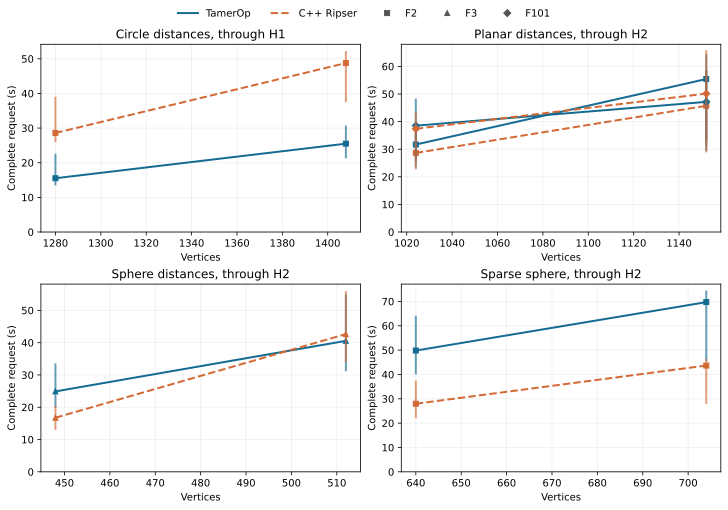
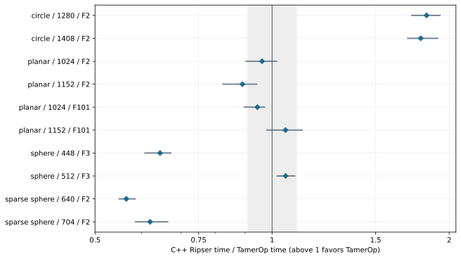

# Ordinary Rips barcodes: TamerOp and C++ Ripser

**Larger-workload comparison v1, 2026-10-06.** This report compares TamerOp with the
original upstream C++ Ripser executable. It is a separate, narrower study
than the [Ripser.py comparison](ripser.md). The larger workloads below return
complete barcodes from supplied distances, without landmarks or cocycles.
The primary numbers include file reading and barcode output, with Julia
compilation warmed and previous mathematical results discarded.

TamerOp's clearest advantage is on the circles: **about 1.8 times as fast**
at both sizes. The 1,408-vertex request takes **25.5 seconds versus
48.8 seconds** in the displayed medians. Dense planar inputs and the larger
sphere are closer; the larger F2 planar request favors C++ by about 12% in the
paired-ratio summary.

C++ Ripser has a clearer advantage on the sparse spheres: **1.61-1.77 times as
fast**, and about **1.55 times as fast** on the smaller F3 sphere. The tables and
figures retain every size, field and observed range.

These are **shared-machine observations**, with substantial variation in
absolute times. Repetitions and reversed ordering describe that variation;
they do not remove systematic contention.

Both tools completed all **10 timed requests** with exactly matching
interval multisets. These results describe the stated inputs, fields and
measurement conditions.

[All benchmark results](index.md) · [Times and sizes](#times-and-sizes) ·
[Machine](#machine-and-builds) · [Download data](ripser_cpp_v1/README.md)

## What this comparison asks

As an edge threshold increases, a Rips filtration adds edges and fills their
cliques. The request is the complete ordinary barcode from H0 through the
stated degree, including essential classes and interval multiplicities.
TamerOp uses its direct ordinary-persistence route. A finite encoding remains
useful for subsequent questions requiring spaces and maps; it is unnecessary
to materialize that richer object just to return this barcode.

The fixed suite contains two sizes each of circle-derived dense distances,
planar dense distances over two fields, spherical dense distances, and
radius-restricted sparse spherical distances. The circle points are equally
spaced on the unit circle; planar points are uniform in the square (-1,1)^2;
spherical points are normalized Gaussian vectors on the unit sphere in R3.
Seeds and the exact generation rules are in the [input definitions](ripser_cpp_v1/fixtures.json).
Supplied grades are Euclidean distances rounded to multiples of 1/4096, shared exactly by Float32 and
Float64. These are the supplied dissimilarities being benchmarked, rather
than unrounded Euclidean distances. Fields are F2, F3 and F101. Sparse omitted
edges are absent, and both tools receive the same already restricted graph.
For sparse requests, essential bars survive the declared cutoff in that
supplied graph; they need not remain essential in the untruncated point cloud.

Sizing pilots targeted roughly 20-40 seconds in C++ on the larger requests;
actual durations differ by input, field and tool. The pilot is excluded from
the reported measurements. Sizes were frozen before confirmation, and neither
implementation was optimized against these results. These synthetic inputs
are not a random sample of applications or an independent reproduction of
the earlier Ripser.py suite.

## Ripser and Ripser.py are different comparisons

[Upstream Ripser](https://github.com/Ripser/ripser) provides a C++ executable
for ordinary Rips barcodes. [Ripser.py](https://ripser.scikit-tda.org/en/latest/)
uses a modified C++ engine behind its Python API and adds workflows such as
landmark selection and retained cocycles. This report uses the standard
upstream branch, not its experimental representative-output branches.
Weighted vertex inputs, raw-cloud distance construction, representative
cocycles and landmark selection are outside this study.

The earlier page measures TamerOp against Ripser.py 0.6.15. Its ratios cannot
be substituted for ratios against this C++ executable. Likewise, comparing
numbers between the two reports would mix different inputs, sizes and timing
boundaries. This page does not measure Python-wrapper overhead.

## Times and sizes

Times below are **seconds**, measured from input-file reading through complete
barcode output. Displayed times are medians of three process medians; each
process contributes two accepted samples. Ratios are geometric means of the
three paired-process ratios, so they need not equal the quotient of displayed
times. Parentheses give minimum and maximum process ratios, **not confidence
intervals**. Values above one favor TamerOp. The symmetric practical-similarity
band is 1/1.10-1.10.

| Input | Vertices | Field / through | Intervals | TamerOp (s) | C++ Ripser (s) | C++ / TamerOp (range) |
| :--- | ---: | :--- | ---: | ---: | ---: | ---: |
| circle | 1,280 | F2 / H1 | 1,281 | 15.5 | 28.6 | 1.83 (1.73-1.93) |
| circle | 1,408 | F2 / H1 | 1,409 | 25.5 | 48.8 | 1.79 (1.70-1.91) |
| planar | 1,024 | F2 / H2 | 1,275 | 31.7 | 28.7 | 0.96 (0.90-1.02) |
| planar | 1,152 | F2 / H2 | 1,429 | 55.4 | 45.7 | 0.89 (0.83-0.94) |
| planar | 1,024 | F101 / H2 | 1,275 | 38.5 | 37.4 | 0.94 (0.90-0.97) |
| planar | 1,152 | F101 / H2 | 1,429 | 47.2 | 50.1 | 1.05 (0.98-1.12) |
| sphere | 448 | F3 / H2 | 574 | 24.9 | 16.8 | 0.64 (0.61-0.67) |
| sphere | 512 | F3 / H2 | 657 | 40.6 | 42.7 | 1.05 (1.02-1.09) |
| sparse sphere | 640 | F2 / H2 | 816 | 49.8 | 28 | 0.57 (0.55-0.58) |
| sparse sphere | 704 | F2 / H2 | 895 | 69.7 | 43.7 | 0.62 (0.59-0.66) |

Lines connect the two measured sizes within the same family and field; they
are guides to the eye, not fitted scaling laws. Vertical marks show the range
of process medians. [Full-size figure](ripser_cpp_v1/presentation/runtime_sizes.svg).

The diamond marks each geometric ratio; the gray segment retains process
variation. All requests, including material losses, remain visible.
[Full-size figure](ripser_cpp_v1/presentation/ratios.svg).

## Timing and fresh computations

Both tools start from the same text distance file. C++ Ripser runs through its
supported CLI in a new process; its timer includes executable launch, input
parsing and barcode printing. TamerOp runs in a loaded Julia process with the
required methods warmed. Its uninterrupted timer includes reading the file,
native construction, the checked public persistence query, and full barcode
emission. Thus this is a comparison of complete requests with compiled code,
with the remaining CLI launch cost explicitly included. It is not a claim
about pure reduction-kernel speed or new Julia-session latency.

Every request rereads its input and builds new mathematical state. TamerOp
uses `cache=nothing`; C++ process exit discards graphs, reductions and results.
Previous answers are used only for verification outside timing. Ordinary reuse
within one computation is retained. Three passes reverse case order on the
second pass and alternate tool order for successive samples. Each case starts
a fresh Julia worker in each pass, giving 30 independent case sessions.
Each case/tool/session has a discarded full warmup before its two accepted
samples. Input hashes and complete outputs are checked throughout. A launcher
termination interrupted the fourth case of the first pass. The three fully
completed case checkpoints were retained; the partial fourth-case warmup was
archived and excluded. Subsequent invocations run one bounded case at a time
with the same timing code, inputs, process layout and limits. The
[recovery record](ripser_cpp_v1/execution_recovery.json) identifies the controller
change; neither implementation changed.

All **120 accepted samples** passed verification; **0 compilation-contaminated samples** were rejected.

The limits were 240 seconds per timed request, 600 seconds for startup or a
Julia warmup, and 6 GiB worker RSS. C++ process completion is polled at 10 ms
intervals; that scheduling granularity is included, not subtracted. It is
small relative to these measured computations. Julia native-construction and
public-query times are available as supporting columns in the downloads.

All final Julia processes use `--heap-size-hint=4G`, a supported
[garbage-collection setting](https://docs.julialang.org/en/v1/manual/memory-management/#Memory-Hints)
chosen for the 6 GiB process guard. GC work inside the request remains timed.
The first attempt with Julia's default heap policy exceeded that guard during
the 1,152-point planar F2 request. Its complete observations are retained
[separately](ripser_cpp_v1/initial_default_heap_observations.json). After a
three-query memory check with identical barcodes, a second shared-session
attempt used the heap hint but also exceeded the cap after earlier cases had
run. Those observations are [retained as well](ripser_cpp_v1/shared_heap_hint_observations.json).
The final protocol starts a fresh Julia process for each case in each pass,
with normal package precompilation, the heap hint, and unchanged inputs,
library source and memory cap. Both earlier attempts are excluded from the
final timing summary. The comparison therefore does not establish that a
single long-lived Julia session stays below this memory budget. These numbers
therefore apply to this runtime configuration, not to every Julia memory policy.

## Correctness and a sparse-cutoff limitation

All complete interval multisets are compared by degree, including essential
bars and multiplicities. Dyadic input grades are separated sufficiently that
upstream Ripser's six-significant-digit printed endpoints decode uniquely
back to the exact input values; the harness rejects ambiguous inputs. Six
small controls additionally agree with an independent explicit simplicial
boundary reduction: spheres over several fields, equal grades, a stored-zero
edge, and a disconnected sparse component.

A separate preflight control exposed a limitation in the pinned upstream
sparse CLI. Supplying a triangle at grade 1 and edges to a fourth vertex at
grade 2 with `--threshold 1` still produces an H0 death at 2. The independent
reference and TamerOp retain that component as essential within the cutoff.
The original failure, expected answer and input are
[preserved publicly](ripser_cpp_v1/sparse_threshold_limitation.json). No speed
ratio is assigned to that incorrect result. The measured sparse inputs are
already restricted to the common radius before either tool reads them; this
does not claim that upstream's arbitrary sparse-cutoff path is correct.

## Machine and builds

The runs used an Intel Core i7-1365U (10 physical cores, 12 logical CPUs),
approximately 31.0 GiB RAM, Linux, and one numerical
thread pinned to CPU 0. This was a monitored workstation, not an exclusively
reserved server. Recorded one-minute load averages ranged from
1.59 to 18.11; the
paired-process ranges above show observed variation. These are shared-machine
observations, so small differences should not be treated as stable rankings
under all machine conditions.

- **TamerOp:** Julia 1.12.1, with the unchanged frozen source snapshot
  from the Ripser.py v1 study; [source hashes](ripser_cpp_v1/candidate_hashes.json).
- **C++ Ripser:** upstream commit `01add51ff64aaf40889483260cc5c3b7d0f2a1e7`, compiled with
  `g++ (Ubuntu 11.4.0-1ubuntu1~22.04.3) 11.4.0`, `-O3`, `NDEBUG` and Robin Hood hashing. F2 requests use
  the upstream binary specialized for F2; odd-prime requests use its supported
  `USE_COEFFICIENTS` build. The competitor's source was not modified.

After normal package precompilation, the 30 case sessions had
a median TamerOp import time of 3.41 s
(range 2.14-6.01 s).
This measures the import inside an already started Julia process after the
harness dependencies were loaded, not total startup or installed-package
latency. Discarded per-case warmups are also included in the raw data; they
are not a matched cold-start benchmark.

## Memory and reproduction

The downloads report sampled process RSS separately from Julia allocation
traffic and retained result size. Julia's column is the per-case process
high-water mark, including its runtime, compilation, warmup and repeated
computations of that case. C++ starts a new process for each call. Their
difference must not be read as a difference in mathematical object storage.
Allocation traffic is cumulative allocation during a call, not simultaneous
resident memory. These measurements accompany the speed results rather than
replacing them.

Across the ten cases, TamerOp's observed case-process peaks range from
2.90 to
5.28 GiB, compared with
0.02 to
2.03 GiB for C++ invocations.
Retained TamerOp barcode objects are only
11.2-48.8 KiB; that small returned object does not account for the runtime or temporary reduction storage.

| Input / vertices / field | TamerOp peak RSS (GiB) | C++ peak RSS (GiB) | TamerOp allocation traffic (GiB/call) |
| :--- | ---: | ---: | ---: |
| circle / 1,280 / F2 | 2.90 | 1.020 | 2.06 |
| circle / 1,408 / F2 | 3.57 | 2.025 | 2.82 |
| planar / 1,024 / F2 | 3.73 | 0.023 | 6.78 |
| planar / 1,152 / F2 | 4.92 | 0.029 | 9.62 |
| planar / 1,024 / F101 | 3.74 | 0.023 | 6.79 |
| planar / 1,152 / F101 | 4.92 | 0.029 | 9.64 |
| sphere / 448 / F3 | 3.85 | 1.014 | 6.64 |
| sphere / 512 / F3 | 5.28 | 2.015 | 9.65 |
| sparse sphere / 640 / F2 | 3.56 | 0.266 | 3.06 |
| sparse sphere / 704 / F2 | 4.04 | 0.271 | 3.78 |

RSS columns are maxima over the accepted observations; allocation traffic is
the median per call. The different process lifetimes described above remain
part of their interpretation.

The [data directory](ripser_cpp_v1/README.md) contains every timing observation,
summaries, the frozen manifest, machine/build details, verification information
and checksums. Original logs, inputs, the pinned upstream checkout and the
resumable harness remain in the local study archive. The public data is not
yet a standalone reproduction bundle. The [benchmarking manual](../benchmarking.md)
describes the requirements for that eventual release.
