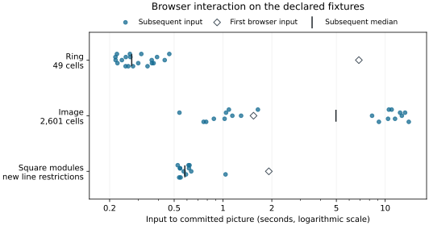

# Continuous inspection: time from input to picture

On the measured browser run, changing the parameter of the 49-cell ring took
**274 ms at the median** after first use. The 2,601-cell image took **4.97 s**,
with a 95th percentile of **13.3 s**. These are complete interaction delays on
a shared desktop using Chromium's software renderer. They show why an inspector
needs to distinguish a pending request from the mathematical answer still on
screen, even when selecting active cells is a relatively cheap calculation.
On the small encoded-module fixture, computing and displaying successive new
line restrictions took **582 ms at the median** after first browser use.

[Measurements](#measured-interactions) · [Conditions](#measurement-conditions) ·
[Raw samples](visual_interaction_v1/measurements.json) ·
[Machine and software](visual_interaction_v1/machine.json)

## What changes when we move a control

The ring is the top-cell array `[0 0 0; 0 5 0; 0 0 0]`. At grade zero its
central face is absent; at grade five that face enters. The larger array has
25 by 25 top cells with values `mod(i+j,5)`. Its 676 vertices, 1,300 edges and
625 faces are all present at grade four. Both fixtures retain their actual
source geometry and grades, so moving the control changes which cells are
displayed without reconstructing a filtration or computing persistence.

The source drawing groups consecutive planar cells with identical styling.
Their identities remain separate for selection and boundary queries. Compatible
updates retain the figure and axes, while changed drawing commands can replace
plots on those axes. The
[implementation account](../implementation/inspection_sessions.md#keep-drawing-objects-when-the-selection-changes)
explains that distinction. This study measures the resulting interactions;
it does not estimate a speed ratio against the former drawing path.

## Measured interactions

Each image fixture has one first browser interaction followed by 20 alternating
endpoint selections. The median summarizes those subsequent samples. The 95th
percentile is the nearest-rank order statistic, here the nineteenth of twenty
sorted values. Repeated measurements in one process are correlated; these
statistics describe this run and are not confidence intervals.

| Retained object and request | First browser query (s) | Subsequent median (s) | Subsequent 95th percentile (s) |
| :--- | ---: | ---: | ---: |
| Ring, 49 cells; grades 0 and 5 | 6.88 | 0.274 | 0.437 |
| Image, 2,601 cells; grades 0 and 4 | 1.54 | 4.97 | 13.3 |
| Two closed squares; distinct line restrictions | 1.92 | 0.582 | 1.04 |

The slice fixture is the direct sum of the closed square modules `[0,2]^2` and
`[1,3]^2`, encoded on nine finite labels over the rational field. One initial
angle-key interaction is followed by twelve successive angles. Every new line
requires a restriction computation: this sequence has no slice-cache hits.
Its 95th percentile is the twelfth sorted sample, hence the maximum. The
figures and axes are retained while their interval data change.



*Input to the committed picture, on a logarithmic time axis. Dots retain all
subsequent observations; their small vertical offsets only separate overlapping
marks. The bars locate the medians. These distributions describe different
requests on this desktop, so their positions do not establish relative
algorithmic efficiency.*

The larger image has a pronounced directional difference. Returning to grade
zero took a median of **11.2 s**, while returning to grade four took **1.03 s**,
with ten observations in each direction. Its pooled median hides that
difference. The smaller active set was therefore not necessarily the quicker
update. The measurement combines Julia preparation, transport and drawing;
it does not isolate the cause of this asymmetry.

The control retains one active calculation and one replaceable pending request.
Rapid input can replace pending coordinates and obsolete results cannot commit.
An already executing Julia calculation is not interrupted. This limits the
amount of queued work, but does not turn a multi-second drawing update into
a continuous animation. The
[session reference](../src/reference/visual_sessions.md#continuous-browser-requests)
specifies the behavior while work is pending.

## Measurement conditions

The study was run on 12 October 2026 on an Intel Core i7-1365U with approximately
31 GiB of RAM, Linux 6.8, Julia 1.12.1, Makie 0.24.15, WGLMakie 0.13.15 and
Bonito 5.2.0. Playwright 1.63.0 drove Chromium 153.0.8010.12 through actual
pointer and keyboard events. Chromium reported ANGLE with SwiftShader, a
software renderer. The ordinary test viewport was 1,440 by 1,050 pixels.

One Julia thread, one BLAS thread and one browser worker were used. Other Julia
tests and documentation work were observed on the same desktop. CPU affinity,
frequency and background activity were uncontrolled. Action and DOM tracing
were enabled, with continuous screenshot recording disabled; the fixture also
published read-only state telemetry every 200 ms. These conditions are part of
the measurements, including their overhead. They do not qualify a hardware GPU,
another browser, a notebook frontend or an isolated workstation.

Timing starts at the browser's actual input event. Completion requires the
matching committed readout, a renderer frame after input and two animation
frames. This is a browser-visible completion proxy, not a GPU fence. Assertions
then verify the committed parameter and active-cell counts, retained figure,
empty error record and successful closure. The ring scenario also checks a
rational coordinate immediately below five, the exact event, rapid requests,
linked viewers and a 480-pixel layout.

Native mathematical and renderer checks ran in the same Julia process before
the browser fixtures. **First browser use is therefore not a cold Julia
computation.** It can still compile previously unused browser paths. Package
loading is outside the timers; the subsequent activity queries scan the retained
grades afresh rather than retrieve cached active sets. The raw opening times
also include accessibility and keyboard checks, so they are not measurements
of startup or time to the first picture.

The slice series was recorded after the activity series and additional native
slice/rank checks, with fresh fixture sessions. Its compilation history is
therefore different. A prior slice attempt exposed a canvas-replacement error;
only the passing series after that repair is included here. The activity
samples remain the originally accepted measurements.

The maintained inputs and interaction protocol are in
[`continuous.spec.mjs`](../../test/browser/continuous.spec.mjs) and
[`complex-fixtures.jl`](../../test/browser/complex-fixtures.jl). Follow the
[browser setup](../../test/browser/README.md) to prepare the pinned environment.
For a run with native prewarming, launch the supplied
[fixture driver](visual_interaction_v1/serve_after_checks.jl):

```sh
OPENBLAS_NUM_THREADS=1 julia --startup-file=no --compiled-modules=existing \
  --threads=1 --heap-size-hint=2400M --project=test/browser \
  docs/benchmarks/visual_interaction_v1/serve_after_checks.jl
```

Wait for `TAMEROP_BROWSER_READY`, then run `continuous.spec.mjs` with
`TAMEROP_BROWSER_REUSE_SERVER=1` as described in the browser setup. Use the
driver's stop-file protocol when finished. The driver performs the focused
checks in one pass; the recorded development session performed its checks in
successive groups before opening fresh fixtures. First-use numbers remain
sensitive to that compilation history.

The
[source identities](visual_interaction_v1/source_sha256.json) identify the
development files accompanying this report; the base commit alone does not
describe its uncommitted implementation changes.
The [figure script](visual_interaction_v1/render.py) draws the retained samples
without further timing runs.
