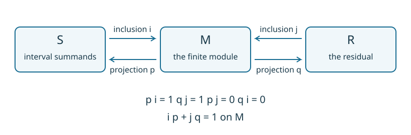

# When does a module split into intervals?

The two-square example gives us a module by putting two simpler modules side
by side. At a parameter covered by both squares its space is two-dimensional;
on an overlap boundary, its map tells us which coordinate continues. Can we
recover those pieces when we are given only the resulting spaces and maps?

Work first on the finite poset of an encoding. This keeps the algebraic
question explicit, whether the original input was a filtration, a lattice
presentation, a collection of geometric regions, or a directly supplied diagram.

## A summand needs a way back

A submodule supplies compatible subspaces. A **direct summand** supplies more:
a module $S$, an inclusion $i:S\to M$, and a projection $p:M\to S$ such that
$p i=1_S$. The projection extracts the chosen component without disrupting
any structure map. Its kernel $R$ is a complement, so $M\cong S\oplus R$.

*The two pieces are modules, not just separate subspaces at each vertex.
Every displayed map must commute with the structure maps of the finite poset.*

For a small obstruction, consider the identity arrow $k\to k$ on the chain
$1<2$. The submodule $0\to k$ certainly exists. A projection onto it would be
zero at vertex 1 and the identity at vertex 2. Those components do not commute
with the arrow: one route gives the identity and the other gives zero.
Thus this submodule does not split.

## Which pieces count as intervals?

An **interval** $I$ in a finite poset is a nonempty connected, order-convex
set. Connected means connected through comparable vertices, ignoring arrow
directions. Order-convex means that $a,b\in I$ and $a\le z\le b$ force
$z\in I$. An interval can branch; it need not be a rectangle or a totally
ordered chain.

The thin interval module $k_I$ has one copy of $k$ at each vertex in $I$ and
zero elsewhere. Maps inside $I$ are identities, and the other maps are zero.
Convexity makes these maps consistent with composition. Connectedness means
that an endomorphism must multiply every nonzero stalk by the same scalar.
In particular, $k_I$ is indecomposable.

The **interval multiplicity** $m_I(M)$ is the number of copies of $k_I$ in a
Krull–Schmidt decomposition of $M$. Equivalently, it is the largest $m$ for
which $k_I^{\oplus m}$ is a direct summand. For finite-dimensional modules on
a finite poset these counts are well defined. This is the multiplicity problem
studied by [Asashiba and Liu](https://arxiv.org/abs/2411.11594).

On the square with arrows $1\to2$, $1\to3$, $2\to4$, $3\to4$, take
$M=k_{\{1,2,3,4\}}\oplus k_{\{2,4\}}\oplus k_{\{4\}}^{\oplus2}$.
Its dimensions are $(1,2,1,4)$. The three displayed supports have multiplicities
$1,1,2$. A change of basis can mix those coordinates at each vertex, but cannot
change the multiplicities. Inclusions and projections recover a splitting in
the supplied coordinates; that choice of maps is generally not unique.

## A rank on a region asks a different question

Return to $k\xrightarrow{1}k$. Restricting to $I=\{2\}$ gives a
one-dimensional space, so its generalized rank is 1. Its multiplicity as the
ambient summand $k_{\{2\}}$ is 0. The incoming arrow, discarded by restriction,
is exactly the obstruction to a retraction.

| Construction | What its numbers describe |
| :--- | :--- |
| Interval-summand multiplicity | Actual copies of $k_I$ inside $M$, with a complement. |
| Generalized rank on $I$ | Compatible persistence through the restricted diagram. |
| Signed interval-family summary | Coefficients reconstructing specified rank queries on a declared family. |
| Matched slice tracks or support approximations | A chosen comparison or approximation, with its own guarantees. |

The last three do not by themselves give inclusion/projection maps for a
splitting of $M$.

## What can remain after every interval is removed?

Intervals do not exhaust the indecomposable modules of a general finite
poset. Put $k$ at each of three incomparable sources and $k^2$ at their common
sink, with image lines spanned by $(1,0)$, $(0,1)$ and $(1,1)$. This module has
no interval summand. To retract onto a piece carrying one source, a functional
at the sink would have to vanish on the other two lines, which span $k^2$.
A piece carrying two sources would require their distinct image lines to
coincide. A sink-only piece would require a functional vanishing on all three.

Every module has a maximal interval-decomposable part, unique up to
isomorphism, with a residual containing no interval summands. That residual
can still split into several non-interval pieces. A complete interval search
therefore answers interval-decomposability without solving general
indecomposable decomposition. With only a chosen family, a nonzero residual
leaves the global question open.

A splitting on an encoding's finite base pulls back along its classifier.
Claiming that it is a complete decomposition in a larger ambient category
requires additional comparison hypotheses. The finite answer alone does not
supply them.

## Continue with the computation

[Compute interval multiplicities and inspect a splitting](tutorials/decomposition.ipynb)
to see the square example in Julia, request actual maps, and compare a complete
search with a chosen family.
