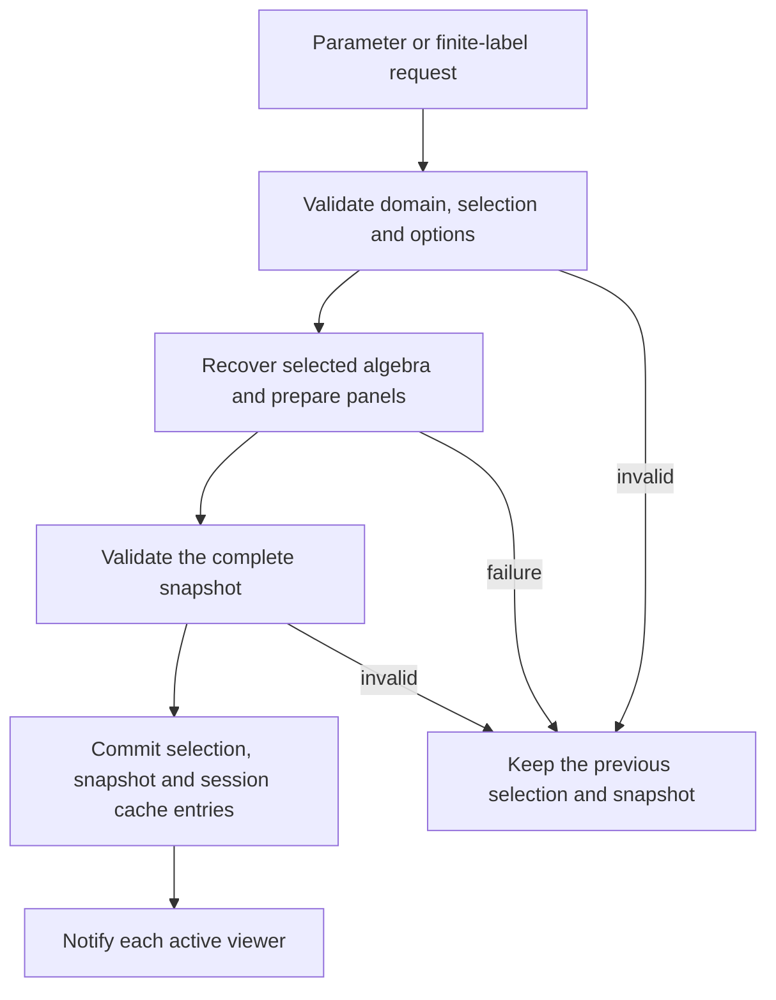
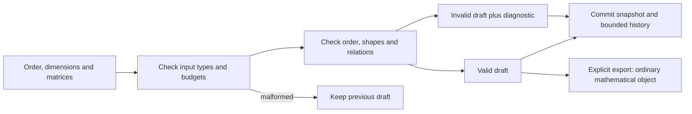
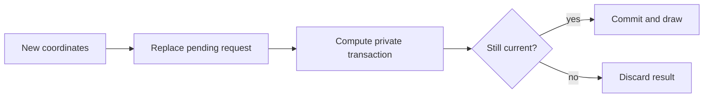

# Linked inspection sessions and browser execution

An inspector joins several answers to one mathematical question. Selecting a
parameter can identify a classifier fiber, a finite-poset label, a vector
space and a matrix. If those panels update independently, the picture can
temporarily assert a relationship that no computation has established.

TamerOp keeps the selection and its prepared answer together in a session.
A renderer observes committed snapshots. Saving a view then preserves the
selected answer as data; it does not preserve the process that computed it.
This account follows that boundary from an exact parameter selection through
live updates and offline restoration. The
[usage guide](../tutorials/live_inspection.ipynb) constructs the square example,
and the [session reference](../src/reference/visual_sessions.md) specifies the
public methods.

## Retain the parameter question as well as its finite labels

Let an encoding assign a parameter $x$ to a finite label $q_x$. A stalk query
reads the space at $q_x$; a comparable pair $x\leq y$ asks for the structure
map from $q_x$ to $q_y$. The session records both descriptions of the request.
Finite labels alone can lose information needed to interpret the answer.

For the square-supported module, the interior parameters $(0,1)$ and $(1,0)$
can lie in the same classifier fiber. Their labels agree, but neither
parameter precedes the other in the product order. There is no prescribed
forward structure map between these parameters. Replacing this pair by the
identity of its common finite label would answer a different question.

The selected state therefore retains original query points, parameter-order
relation, finite vertex or pair, view and input origin. Exact numerical or
typed input is distinguished from approximate pointer input. Interval
inspectors similarly retain a multiplicity-group ID and an original member:
equal endpoints do not identify which retained representative the user chose.
Slice interval IDs are local to the current line, so changing that line clears
the interval selection.

Prepared navigation data belong to the session. A finite module supplies its
poset and dimensions; a supported planar encoding also supplies classifier
geometry. The finite Hasse layout is schematic. Its drawing positions neither
replace the parameter assignment nor define new order relations.

## Build a candidate before committing an update

An update validates the requested selection, prepares its mathematical answer
and builds the complete snapshot before replacing the current state. For a
module inspector, the sequence is:



*The browser sees a committed answer. Validation and mathematical preparation
do not publish partially updated panels.*

The session lock protects the state transition. A busy flag also rejects a
reentrant update during listener notification. Listener failures are recorded
after a successful commit; they do not undo an already valid mathematical
selection. The error record is bounded. Underlying mathematical owners can
maintain their own caches during a query, so rollback of a session request
does not imply rollback of every benign computation elsewhere in the package.

The same pattern supports other selected questions. A signed-measure session
computes the candidate contribution sum and any supplied direct answer before
committing. A spectral or chain inspector validates its page, index or vector
against the relevant mathematical owner. Shared lifecycle rules do not make
their selections mathematically interchangeable.

## Select a region without conflating its domains

A generalized-rank session retains either a connected convex finite-label
selection or a continuous worm on a positive two-dimensional grid encoding.
The first uses the selected diagram; the second uses the encoding's explicit
zero-below, constant-above extension. These contracts select different
restrictions of the retained module. Their algorithms belong to
[generalized rank and GRIL](generalized_rank.md).

An encoding input is resolved through `encoding_module`. For a lazy encoding,
this materializes and caches its finite module, including the structure maps,
before the inspector validates query and drawing budgets. Those budgets bound
the selected calculations and displayed finite base; they do not bound that
initial materialization. A session then reuses the retained finite object.

Finite-region matrices and the grid boundary barcode are explicit requests.
Changing only a boundary occurrence or bar reuses that barcode. A new finite
region clears occurrence selections, whose identities belonged to the old
path. Worm width changes reuse the landscape at the retained center and probe
family; changing a displayed rank level reuses both its width and the current
worm rank. A changed center requires a new landscape. Reuse retains one
current answer rather than an unbounded history of visited regions.

The renderer receives the exact domain and answer together. Its floating
polygon is a drawing of the continuous closed worm, not a collection of sampled
grid vertices. Exact coordinate entry and approximate pointer positions stay
distinguishable in the interface. Hover reads retained metadata. Domain,
field and resource failures occur before commit, so an invalid selection
leaves every linked viewer on its previous answer.

## Keep a draft distinct from a mathematical object

Authoring has a different failure boundary from selecting an answer. If a user
changes the last map of an identity diamond from 1 to 2, the draft should show
that change and explain why it fails. Rejecting the entire edit would erase the
very relation the user needs to understand. `ModuleEditorSession` therefore
retains numeric input and a validation report, with construction of an ordinary
`PModule` or finite `FringeModule` behind a separate checked export operation.
The [construction guide](../tutorials/presentations.ipynb) follows this example.



*Mathematical invalidity is an inspectable editing state. It is never exported
as a purported module. Syntax errors and oversized inputs do not commit.*

A module draft stores the reflexive transitive relation, one dimension per
vertex and cover matrices in target-by-source orientation. It constructs the
finite poset and checks dimensions, exact cover coverage and matrix shapes
before asking `Modules.module_path_witness` about path independence. A fringe
draft instead stores upset/downset memberships and their coefficient matrix.
`FiniteFringe.check_fringe_data` checks closures and allowed intersections;
selected stalk panels use the image of the active coefficient submatrix.
Neither route invents an ambient classifier from the finite drawing.

The path diagnostic works source by source in a topological ordering of the
cover graph, so vertex IDs need not already be topological. It retains one
path and its composite to each reached vertex. Every alternative incoming
edge extends a previously checked prefix and compares its product with the
stored path. If all earlier prefixes agree, agreement at every such merge
implies agreement of every path, by induction along the ordering. This also
checks a two-edge route against a three-edge route when no elementary square
is present. For real fields, this statement is interpreted through the owner's
configured tolerance rather than as an exact algebraic certificate.

On the scalar diamond, the stored route $1\to2\to4$ has product 1, while
$1\to3\to4$ has product 2. The snapshot highlights both routes with distinct
line styles and retains both matrices. It does not reconstruct either product
from a possibly stale module cache. With $n$ vertices, $m$ covers and stalk
size at most $d$, the traversal performs at most order $nm$ dense products
of cost up to $d^3$, in addition to validation of the finite order. Per-source
storage includes composites of up to $d^2$ entries and explicit vertex paths.
It is a diagnostic for bounded authoring, not a replacement for cached map
queries in large computations.

Each edit normalizes a fresh candidate, validates it and prepares the snapshot
before changing the session. Undo retains bounded copies of preceding inputs
and selections; redo is discarded after a new edit. Selection-only navigation
does not create an edit-history entry. Reset restores the initial input as an
ordinary undoable edit. No coefficient matrix is silently resized when a
stalk dimension changes. The entry, dimension and history limits bound retained
input independently of the matrix crop used to draw the result. Revalidation
currently reconstructs the small object on each edit; an incremental algorithm
would have to preserve the same full relation and witness contract.

The live browser exposes these operations through labelled text tables and
buttons. Coefficients are parsed as numeric literals, with explicit matrix
shape for zero-dimensional stalks. Exported Julia is generated from checked
numbers; imported text is never evaluated. Saved snapshots retain declarative
draft data and diagnostics through the owned value codec. Reopening invokes
the ordinary editor constructor and validates anew, with no previous history
or executable callback. Thus an invalid saved draft remains useful without
being confused with a serialized mathematical module.

## Reuse the answer at the level where it remains valid

For finite-module inspection, geometry and layout are prepared once. Selected
algebra uses a bounded cache. A rank section retains a row or column for its
finite anchor, avoiding a full all-pairs rank table. Moving an exact parameter
within the same fiber can reuse that row, but its original-parameter order
mask must still be rebuilt. The square's incomparable pair explains why that
last step matters.

A selected slice retains its current restriction. Changing only a barcode
member reuses it; changing the line or its scope requests a new restriction.
Finite-window and whole-line calculations preserve different endpoint claims.
A viewport boundary can censor a bar without proving that it is essential.
The interval representation and display semantics are described with the
[visual specifications](visual_specs.md).

Signed-measure inspection has another reuse boundary. A supplied direct
callable checks the original observable at the chosen query and smoothing.
Changing only the displayed term or view keeps that answer. Changing the
query or smoothing calls it again. An agreement at one query is still only an
agreement at that query; the cache does not turn it into a global certificate.

Budgets have separate meanings. A matrix display limit bounds the entries
shown, not the work needed to construct the selected map. A slice limit bounds
event strata before its rank calculation. Cache capacities bound retained
answers. Saving several snapshots introduces another retention cost: each
prepared state keeps the graphical and mathematical data needed to explain it.

## A viewer observes a session; it does not own its mathematics

The WGLMakie extension renders the session through Makie and Bonito. Controls
translate finite-label choices, typed coordinates or pointer positions into
the same selection operations available in Julia. Typed exact coordinates
settle boundary queries; pointer coordinates retain their approximate origin
in the state and readout.

Each viewer owns its DOM controls, scene observers and subscription to the
session. Several viewers can follow the same committed state. Removing one
viewer's handlers releases that client without requiring every other viewer
to disappear. Explicitly closing the session notifies all remaining clients,
then releases listeners, input objects, prepared navigation data and caches.
The final static snapshot remains available.

These are live Julia computations. A browser event must reach the running
session and its response must reach the rendered client. Calling a Julia
selection function directly exercises the mathematical transition but does
not establish keyboard, pointer, transport or disposal behavior in a browser.
The [browser-checking guide](../../test/browser/README.md) explains how to
exercise that separate execution boundary.

## Move a control while a query is running

A filtration cursor or slice handle can produce more requests than Julia can
compute and the browser can draw. The session therefore retains one executing
request and one pending request. Another movement replaces the pending request
with the latest coordinates. This keeps the amount of waiting work bounded even
when a restriction calculation takes longer than the gesture that requested it.

The worker copies the transaction-owned state and bounded cache containers,
sharing the read-only mathematical input and prepared geometry. It computes on
that private transaction. Before publishing the answer, it checks both the
request generation and the visible session revision. A later gesture changes
the generation; a direct exact selection changes the revision. Either makes the
older answer obsolete, so its snapshot and new session cache entries are
discarded. A valid latest answer passes through the same notification mechanism
as a synchronous selection.



*The pending coordinates can change while a transaction is being prepared.
The last check concerns the requested mathematical state, so an old answer
cannot replace a newer selection merely because it finished later.*

The worker allows a short interval for a burst of events to coalesce before
starting another query, and yields before its final check. It does not interrupt
an executing algebraic operation. Closing the requesting viewer invalidates its
work; closing the shared session also releases the inputs after notification.
A private calculation that has already started can finish and be discarded.
Underlying mathematical owners may retain their own benign caches, just as they
can during an unsuccessful synchronous query.

Connected complex controls and exact slice Apply use this worker as well.
Inserting a new WGL plot can wait for an acknowledgement from the browser.
Running that insertion inside Bonito's incoming-message callback would prevent
the same message task from receiving the acknowledgement. Enqueuing the query
lets the callback return before drawing begins. Direct Julia selections remain
synchronous, and exact browser entry keeps the entered coordinates unchanged.

The distinction between activity and persistence remains consequential. Selecting
cells scans their stored appearance grades. A geometric viewer additionally
computes the requested invariant. Its radius barcode depends on depth, so the
current barcode can be reused when only radius or cell selection changes.
An encoded-module slice uses the existing bounded restriction cache; choosing
a new line can require new ranks and intervals. Neither path reconstructs the
source filtration or estimates a new density.

## Keep drawing objects when the selection changes

Moving the selected point in a coordinate field changes its section values and
markers, while the axes and colorbars usually have the same roles. Selecting
another matching pair similarly changes highlighting and readouts within a
fixed assignment. These viewers retain their figures and plot buffers. Retained
complex viewers also keep compatible source axes as cells enter and leave.

The renderer prepares drawing commands from the committed specification before
updating the canvas. It first compares panel identities, coordinate planes,
legends and command shapes. Compatible commands update their arguments and
attributes together through [Makie's coordinated update API](https://docs.makie.org/stable/explanations/observables).
An unchanged command does no drawing work. Axes retain the reader's viewport
when their declared coordinate limits have not changed, and existing pointer
handlers continue to refer to the same scene.

For a complex with unchanged panel roles and legends, a changed number of
cell drawing commands replaces those plots on the existing axis. The axis
keeps its limits and, in three dimensions, its camera.

Moving a slice similarly updates its barcode and diagram on retained axes.
Interval counts and endpoint decorations can change, so their drawing commands
may be replaced while the canvas remains. Picking reads the current interval
records after each update. This avoids repeatedly replacing browser canvases
whose asynchronous initialization might still be waiting for delivery.
The interval axes follow the newly computed endpoint range; the source view
keeps its own coordinate frame.

Planar source cells with consecutive identical styling share a drawing primitive.
Faces, edges and vertices keep their paint order; a selected cell or a change
to faint inactive context separates the groups. Picking still uses the retained
cell identities and centers, so grouping the drawing does not merge cells in
the mathematical complex. This also allows a changing active set to update a
few polygon, path and point buffers when their roles remain the same.

A disconnected browser can release a drawing screen before its final close
notification reaches the viewer. The refresh checks the browser session before
inserting plots and disposes an ended viewer. Other viewers continue to use the
shared mathematical session.

Changing the panel layout or contour legend constructs a new
figure offscreen and replaces the displayed canvas once. This avoids inserting
many new graphics objects during a browser event. The old figure and observers
are released after replacement. Literal matrix layouts and semantic composition
continue to use their own rendering paths; this retained-buffer mechanism does
not claim to update every type of figure. Each viewer owns one current drawing
plan, with no shared scene cache or accumulated selection history.

## Reuse a declared atlas

Keeping several source states visible together helps a reader follow both
parameter directions. Figure 1 of [Loiseaux and Schreiber's multipers paper](https://doi.org/10.21105/joss.06773)
uses such a grid, while Figure 3 of [Fersztand and Jendrysiak's Skyscraper paper](https://doi.org/10.4230/LIPIcs.SoCG.2026.47)
places a sampled bifiltration beside its homology diagram. These are visual
precedents for the atlas. Its algebra comes from TamerOp's existing homology
and module-map operations.

An atlas makes its expensive selection domain finite before a browser opens.
The caller declares a list of parameter states or a small coordinate grid, and
construction prepares the spaces and all supported endpoint maps. For source
complexes, the [representative account](source_representatives.md#explain-a-transition-between-sampled-parameters)
describes the homology inclusions and optional cycle/filling witnesses.

The session retains a source index, target index, event kind and witness index.
Changing these values selects among prepared mathematical answers; it does not
recompute homology. A candidate with an unavailable witness or an invalid state
index rejects before changing the committed snapshot. An incomparable pair is
a valid selection with no map, which the readout distinguishes from a zero
matrix for a comparable pair.

Each viewer keeps one contact-sheet canvas throughout selection. The source
coordinates, finite-poset layout, and cameras therefore remain aligned while
the reader compares states. Its transition detail contains the selected matrix,
cell entries, or retained witness charts. A changed detail replaces only that
figure and releases the previous one. Connected controls use the common request
worker so browser transport remains available while WGL installs the new plots.
Hover reads prepared state labels and dimensions without making a request.

Saved atlas selections use the snapshot route. They retain their contact sheet,
selected matrix, source-cell records and witness coefficients in a portable
collection, but carry no request for reconstructing the live atlas input.
Choosing a saved state offline therefore shows another prepared answer rather
than performing a new parameter query. This distinction is independent of
whether the original declared samples covered every event; atlas construction
makes no exhaustive-coverage claim.

## Freeze data, then choose how it will reopen

`visual_state` captures a static specification, exact selection and
declarative construction request. It copies the retained data needed by the
frame so a later live selection cannot rewrite the saved answer. Executable
callbacks, renderer objects and runtime caches are not part of that contract.
Unsupported opaque metadata is reported as omitted; it is not silently
advertised as recoverable mathematical data.

The save call separately records the collection's style and figure size.
A renderer's current palette cannot be inferred from the mathematical session;
preserving a nondefault style requires supplying it when saving.

A resumable frame also fingerprints its complete supported source. This can
materialize a lazy finite module and validate its cover maps. The digest belongs
to the whole retained mathematical object, not only the selected readout: a
change elsewhere in the module must not be hidden because one map stayed the
same. Capturing a static specification instead retains no live reconstruction
request or source fingerprint; the selected data can still be supplied:

```julia
visual_state(Advanced.inspection_snapshot(session);
    selection=Advanced.inspection_selection(session))
```

When an artifact includes or references a source, saving checks its identity
against every resumable frame and replays the supported requests. The resulting
selection and prepared answer must agree with the frozen state. This costs
fresh query work, but prevents a caller from attaching an unrelated object
beneath an otherwise plausible saved figure. An identity mismatch rejects even
when the currently selected matrix happens to agree.

There are two restoration routes:

| Route | Reconstructed result | New mathematical work |
| --- | --- | --- |
| Load a saved frame | The recorded snapshot and exact selected data | None merely to recover the prepared answer; rendering still costs work |
| Resume a supported inspector | A new session from an included or checked referenced object and its declarative request | Normal constructor and selection queries, with fresh caches |

A closed inspector can still contribute its static answer. It cannot supply
the live object it has already released. Live restoration is supported for
finite modules, supported encodings and ordinary persistence diagrams. Other
inspectors can have portable snapshots without having a live reconstruction
route. A saved closure is never used to fill that gap.

For an encoding, preserving its mathematical isomorphism class is insufficient
to preserve a displayed coordinate matrix. The saved source therefore also
retains the original finite module's coordinates. The
[serialization account](serialization.md) explains this distinction and the
content checks used for external resources.

## Offline interaction selects among prepared answers

HTML export asks CairoMakie to render each retained state to SVG. The file
embeds those images, the session record, plotted values and its own small
state-selection program. The browser changes the selected image and associated
records; it performs no new module, persistence or geometry calculation.
Download controls expose the selected SVG, exact plotted-value record and
complete session JSON. A URL fragment names a saved state.

The HTML route uses data text and explicit DOM updates, never executable
metadata. Its bundled script and style are identified by hashes in the page's
content policy, with no network resources required. A browser without script
execution can still display the initial figure; switching states needs the
bundled program.

An authored annotation remains authored. A previously checked connector keeps
its frozen coordinates and recorded evidence status. Reopening a static
picture does not perform the source-certificate calculation again or establish
a new correspondence to a changed mathematical object.

The cost of a portable collection includes the preparation and rendering of
each state, complete-source fingerprints for resumable captures, source/query
checks when attaching a mathematical object, and stored specifications and SVG.
Switching states is inexpensive
because that work has already happened. This favors a small collection of
meaningful selections over trying to precompute an unbounded inspector.

## Implementation locations

| Concern | Source |
| --- | --- |
| Exact module state, transactions, cache and lifecycle | [`inspection_session.jl`](../../src/visualization/inspection_session.jl) |
| Bounded browser requests and obsolete-result rejection | [`inspection_requests.jl`](../../src/visualization/inspection_requests.jl) |
| Grade ranges, exact events and coordinate conventions | [`filtration_controls.jl`](../../src/visualization/filtration_controls.jl) |
| Interval groups and retained members | [`inspection_intervals.jl`](../../src/visualization/inspection_intervals.jl) |
| Signed-query reuse | [`inspection_signed.jl`](../../src/visualization/inspection_signed.jl) |
| Capture, saved-state access and live reconstruction | [`saved_sessions.jl`](../../src/visualization/saved_sessions.jl) |
| Browser controls and observers | [`visualization_wgl_inspection.jl`](../../ext/visualization_wgl_inspection.jl) |
| Continuous controls and native canvas gestures | [`visualization_wgl_controls.jl`](../../ext/visualization_wgl_controls.jl), [`visualization_wgl_slices.jl`](../../ext/visualization_wgl_slices.jl) |
| Portable SVG states, data controls and offline browser program | [`session_html.jl`](../../src/visualization/session_html.jl) |

## Linked coordinate sections

A field session owns copied sampled arrays and one selected index per coordinate.
Every plane varies its own two coordinates and fixes the rest at that shared
point. Thus moving a coordinate may change one panel's data while moving only
the marker in another. The stored layer is a stable string identity; the color
range spans all layers so changing a layer does not silently rescale the picture.
Changing a baseline or normalization triggers a new global scale scan.

Updates validate the complete candidate state and build its snapshot before
publishing either. A failed plane, index, layer or budget request leaves the
previous snapshot available. The shared inspection notification mechanism then
refreshes all attached viewers. Each WGL viewer owns its canvas, native event
observers and browser controls; closing that viewer detaches those resources.
Closing the session releases the sampled arrays and listeners while keeping
its last static snapshot. The selected plane copies remain available for export.

A native chart click chooses the nearest stored sample on that plane and updates
its two selected indices. It does not evaluate a continuous invariant between
samples. Sliders operate on labeled stored indices, while figure subtitles give
the actual fixed-coordinate values. The controls require a running Julia process;
static HTML contains the prepared figure without these callbacks. This session
does not add a saved-source reconstruction contract to the portable session codec.

[Bibliography](references.md).
