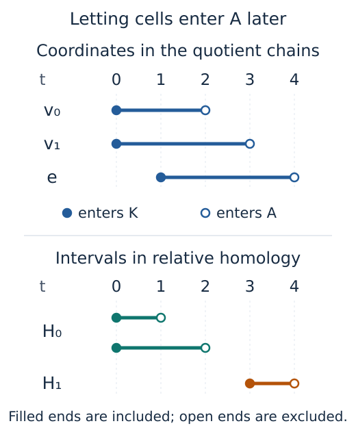

# Computing persistence of a filtered pair

A relative class is represented by a chain whose boundary lies in a designated
subcomplex. For a segment $K$ and its endpoints $A$, the edge is such a chain:
its boundary vanishes when we work modulo the endpoint chains, while the edge
remains. Relative homology lets us ask what is left when a boundary or reference
region is counted as zero. The
[segment recipe](../recipes/relative_pair.md) computes this class and the map
that recovers its endpoint boundary.

The computational difficulty is that $A$ can grow independently of $K$.
A cell may enter $K$, contribute to relative homology, and later enter $A$.
The quotient chain spaces can therefore lose coordinates even though both
input filtrations only grow. TamerOp chooses between two reductions according
to when the cells enter $A$. Queries for explicit chains and maps always use
the actual quotient, so their coordinates retain the meaning of the original
cells. The [reference](../src/reference/persistence_variants.md) specifies the
input, field, scale and matrix conventions.

## Keep both entry times

A `FilteredPair` stores a copy of the graded complex for $K$, the positions
of the selected cells of $A$ within each chain degree, their entry grades in
$A$, the coefficient field and the filtration order. Positions identify cells
even when their supplied labels repeat. A cell's grade in $K$ and its grade
in $A$ record two different events.

For sublevels, each selected cell $\sigma$ must satisfy

```math
\operatorname{grade}_K(\sigma)\leq\operatorname{grade}_A(\sigma).
```

This ensures that the cell is already in $K$ when it enters $A$. Every
boundary term with a nonzero coefficient must also belong to $A$ and enter
no later than $\sigma$. Superlevels reverse these inequalities. Boundary
equations are checked over the requested prime field, including signs.
The check establishes a chain subcomplex spanned by selected cell coordinates;
it does not infer a geometric realization from the cell labels.

At a scale $t$, write $C_d(K_t)$ for the vector space of chains on the active
$d$-cells of $K$, and similarly for $C_d(A_t)$. In the relative chain space

```math
Q_d(t)=C_d(K_t)/C_d(A_t),
```

the remaining active cells form a basis. To compute its differential, restrict
the ambient boundary matrix to the remaining source and target coordinates.
The omitted terms lie in $A_t$ and hence are zero in the quotient. Since the
boundary of a chain in $A_t$ stays in $A_t$, this quotient operation is
well-defined and its differential still has square zero.

## Decide whether one quotient complex suffices

If every selected cell inherits its grade from $K$, it becomes zero in the
quotient as soon as it appears. Removing those cells once produces a graded
chain complex whose ordinary persistence reduction gives the relative
barcode. This includes an empty $A$ and the equal pair $A=K$.

To see why a later entry needs a different construction, keep the segment
whose vertices enter $K$ at zero and whose edge enters at one. Let its
vertices enter $A$ at two and three, and its edge at four.



*The quotient contains an edge before it contains a relative cycle. At three
both endpoint terms in its boundary have become zero; at four the edge
itself becomes zero. Removing all eventual $A$-cells at the start would
lose the interval $[3,4)$.*

For this case, TamerOp builds the **mapping cone** of the inclusion
$i:C(A)\to C(K)$. Here the cone is an algebraic chain complex: retain the
$K$-cells and add a copy of every $A$-cell one degree higher. Write $s a$
for this shifted copy of a chain $a$. Thus

```math
\operatorname{Cone}(i)_d=C_d(K)\oplus C_{d-1}(A),\qquad
D_d=
\begin{pmatrix}
\partial_K&i\\0&-\partial_A
\end{pmatrix}.
```

The $K$ block receives its original grades, and the shifted $A$ block
receives the grades at which those cells enter $A$. The identity
$\partial_K i=i\partial_A$ says that inclusion respects boundaries;
together with the minus sign, it gives $D^2=0$. In the implementation,
negated coefficients are formed as residues modulo the prime, avoiding
signed integer overflow even for the smallest machine integer.

### The delayed segment inside the cone

Call the vertices $v_0,v_1$ and orient the edge $e$ so that
$\partial e=v_1-v_0$. The cone's degree-one coordinates are
$e,s v_0,s v_1$, entering at one, two and three. Its degree-two coordinate
$s e$ enters at four. With target rows and source columns, the boundary
matrices are

```math
D_1=
\begin{pmatrix}
-1&1&0\\
1&0&1
\end{pmatrix},\qquad
D_2=
\begin{pmatrix}1\\1\\-1\end{pmatrix}.
```

Rows of $D_1$ are $v_0,v_1$, and rows of $D_2$ are $e,s v_0,s v_1$.
At three the chain $e+s v_0-s v_1$ becomes available, and multiplying
its coefficient column by $D_1$ gives zero. At four this chain is the
boundary $D_2(s e)$. We have recovered the interval $[3,4)$ using coordinates
that only enter the cone, without having to delete them during reduction.

### Why the cone gives the relative persistence module

The projection $p_t:(k,a)\mapsto[k]$ from the cone to the quotient is a
chain map. Its kernel consists of pairs with $k\in C(A_t)$, so it is the
cone of the identity on $C(A_t)$. This kernel has no homology: the map
$h(u,a)=(0,u)$ raises degree by one and satisfies $Dh+hD=\mathrm{id}$.
For a cycle $z$ in the kernel, this equation gives $z=D(hz)$, showing
that the cycle is a boundary. The short exact sequence of chain complexes
therefore makes $p_t$ an isomorphism on homology, a property called a
**quasi-isomorphism**.

These projections commute with the maps as $t$ changes, because both
routes send $(k,a)$ to the class of the same ambient chain $k$. The
homology isomorphisms consequently identify the entire persistence modules,
including their maps. We can compute the relative barcode by applying the
ordinary reducer to the cone's growing filtration.

| Subcomplex entry | Reduction input | Chain coordinates |
| :--- | :--- | :--- |
| $A$ inherits every selected grade from $K$ | Graded quotient | Cells outside $A$ |
| Any selected cell enters $A$ later | Filtered cone of inclusion | $K$-cells and shifted $A$-cells |

Both inputs pass through the shared ordinary persistence reducer. The
returned intervals describe relative homology in the original grading.
The quotient construction and connecting map are standard relative homology;
see [Allen Hatcher, *Algebraic Topology*, Section 2.1](https://pi.math.cornell.edu/~hatcher/AT/ATch2.pdf).
[Blaser and Brun, *Relative Persistent Homology*](https://doi.org/10.1007/s00454-022-00421-9)
develop the persistent quotient viewpoint and relative geometric constructions.
TamerOp's general pair route does not implement their specialized
Delaunay–Čech construction.

## Recover maps in actual quotient coordinates

A barcode request does not choose homology bases at every scale.
`relative_complex(pair; scale)` constructs $C(A_t)$, $C(K_t)$ and $Q(t)$
directly, retaining the ambient identity of each coordinate. A filtration
map places an old coordinate in its corresponding new row. In the quotient,
that coordinate may have entered $A$ by the target scale, in which case
its image is zero.

`relative_homology` passes each complex's adjacent boundary matrices to the
shared homology engine. The engine chooses cycle representatives and computes
coordinates modulo boundaries. Given these bases, inclusion and quotient
projection act on the source cycles; the engine then expresses their images
in the target homology basis. Induced filtration maps use the same procedure.

For the connecting map, lift a quotient cycle $z$ to its complementary
ambient coordinates and take its ambient boundary. The quotient cycle
equation says that this boundary lies in $A$. Its coordinates in
$H_{d-1}(A)$ give

```math
\delta[z]=[\partial_K\widetilde z].
```

A different lift differs by a chain in $A$, so its boundary changes by a
boundary in $A$ and gives the same homology class. Changing $z$ by a relative
boundary adds an ambient double boundary and possibly a boundary in $A$;
both give zero in $H_{d-1}(A)$.
On the oriented segment, the map sends the edge class to $[v_1]-[v_0]$;
over $\mathbb F_3$, its coefficient column is $(2,1)^{\mathsf T}$ in that
vertex order. The matrices depend on the chosen bases. Exactness of the
sequence and commutation with filtration maps are statements about the
underlying linear maps and do not depend on those choices.

## Storage, reuse and the boundary of the result

The quotient route has one coordinate per cell outside $A$. The cone has
one per $K$-cell and one shifted coordinate per selected $A$-cell; its sparse
boundary adds the inclusion entries and the shifted $A$-boundaries. Both
routes use the established persistence reducer over the selected prime
field, without a separate persistent elimination engine or result cache.

Explicit snapshots copy their source pair and store the selected sparse
boundaries. Homology queries can materialize dense cycle matrices and the
factors used to solve for coordinates. Reuse a homology snapshot when
inspecting several maps at one scale, so these factors remain available.
Snapshots at different scales carry separate chosen bases and must be
related by their induced maps.

The diagram records original cell labels, selected positions, both grade
sets, field, order and the reduction route. Its interval, analysis and JSON
interfaces remain available. The artificial cone coordinates are not
returned as original cell representatives, and pair metadata alone cannot
reconstruct omitted boundary matrices or source geometry. The explicit
quotient queries supply representatives in ambient cell coordinates, without
asserting a matching between these bases and individual barcode intervals.

Implementation: [`relative.jl`](../../src/ordinary_persistence/relative.jl)
and the shared [homology engine](../../src/ChainComplexes.jl).

[Bibliography](references.md)
