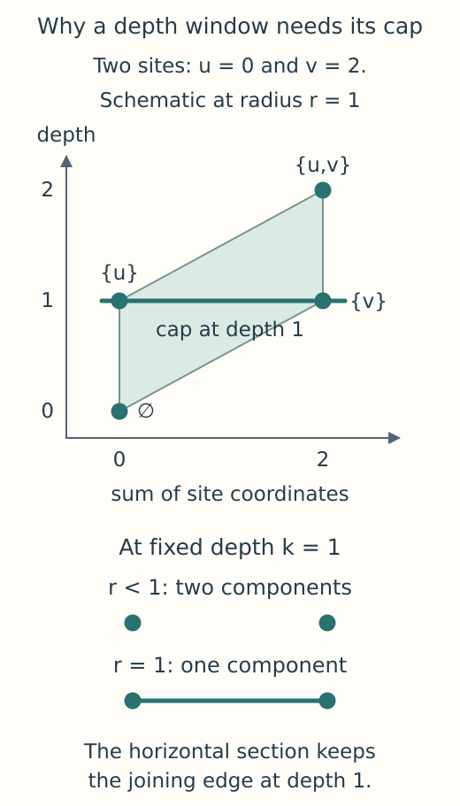

# Exact rhomboid multicover construction

Take two sites at $(0,0)$ and $(2,0)$ and grow closed balls around them.
At radius one, a location first belongs to both balls, and their union becomes
connected. The same event is seen at two coverage depths. A finite model of
multicover must describe these spaces together with the maps obtained by
increasing radius or decreasing the required depth.

TamerOp builds a graded cellular complex: cells with boundary maps and grades
specifying when they appear. It can then encode the homology over a finite
parameter poset. The geometric inspector retains this same complex before
encoding, so it can relate a selected cell to the source sites and its birth.
We will follow the construction from site labels through exact radii to signed
boundaries. The [multicover guide](../tutorials/multicover.ipynb) computes the
two-site example and a square whose loop eventually fills.

## From spheres to cells

A separating sphere partitions the indexed sites into an inside set $I$, an
on-sphere set $O$ and the remaining outside sites. The native rhomboid has
label $(I,O)$ and dimension $|O|$. The general position hypothesis excludes extra cospherical sites in the
relevant geometry, so the on-sphere directions give it the face structure of
a cube. Moving one
site from $O$ into $I$, or from $O$ to the outside, chooses one of the two
opposite faces in that direction. Shared faces are identified by these labels.

This is the rhomboid model of
[Corbet, Kerber, Lesnick and Osang, Section 4](https://arxiv.org/html/2103.07823v3).
Its vertices correspond to subsets $S$ with $I\subseteq S\subseteq I\cup O$.
For sites $a_i$, the inspector places them at

$$
v_S=\left(\sum_{i\in S}a_i,\ |S|\right).
$$

The last coordinate counts sites and gives positive depth; reflecting it
recovers the usual negative depth convention. Thus planar input has a cell
model in three dimensions. The spatial coordinate is a sum, so dividing it
by depth to obtain a mean would change this geometry. Projecting away depth
changes the drawing, whereas selecting a depth section changes the complex.

*In this schematic the sites lie on a line, so the lifted cell has two
coordinates. The full rhomboid has the four subset vertices shown. Cutting
at depth one gives a joining edge that is absent before its birth radius;
it is a new face of the sliced model.*

Exhaustive discovery enumerates affinely independent supports containing one
more site than the affine dimension. It solves for circumspheres and
classifies the sites with rational arithmetic in the original Euclidean
metric, even when the cloud lies in an affine subspace of smaller dimension. Faces are
inserted recursively and shared through their labels. Extra cospherical sites
in relevant geometry violate the native contract and cause an error, rather
than an arbitrary choice of diagonal or a perturbation of the sites.

An alternative route discovers the labels across successive depth levels.
Both routes feed the same radius and boundary construction; we return to
that discovery algorithm below after explaining what its cells must retain.

## A birth radius is a constrained minimum

Fix a label $(I,O)$. A realizing sphere must touch the sites of $O$, enclose
those of $I$ and leave the outside sites outside. The smallest sphere through
$O$ alone may violate one of the other conditions. If so, a minimum subject
to all the conditions can occur where another site becomes tight, placing it
on the sphere of a coface, a larger cell containing the original one.

The implementation therefore works from higher dimensions downward. It
accepts an unconstrained circumradius when its exact site classification is
feasible, then passes each coface's minimum to its faces and keeps the least
feasible squared radius. The empty anchor vertex has radius zero. If a
required realizing coface is missing, the constructor reports an error.

These squared radii are rational. The constructor takes an exact algebraic
square root when emitting grades, so $r^2=2$ becomes $r=\sqrt2$ with equality
preserved at the birth event. Finite floating inputs are interpreted as their
exact binary rational values. A radius cutoff is converted exactly before
squaring; multiplying it in floating arithmetic first could change the
boundary being requested. The inspector reports both radius and squared
birth radius while selecting cells with the physical radius parameter.

## Incidence, windows and finite encodings

Ordering the sites of $O$ orients each cube. Removing a direction gives two
facets with opposite boundary coefficients, and the sign alternates across
directions. A shared face has one identity in the boundary matrix. These
integer coefficients can be used over any admitted coefficient field without
reconstructing an orientation from a polygon drawn on screen.

A cell in the unsliced model has grade $(\rho(I,O),|I|)$, where $\rho$ is its
constrained birth radius. For a bounded depth window, the constructor takes
horizontal sections at integer depths and closed slabs between them. It does
this before imposing `max_dim`, since a higher dimensional cell can contribute
a cap of one lower dimension. The two-site window `(1,1)` consists of the
horizontal section in the figure: its joining edge survives although no slab
of positive width does. The [depth guide](../rhomboid_depth.md) gives the
radius pruning argument, cap comparison and signed boundary formulas.

A request for `stage=:simplex_tree` additionally subdivides the cells. For
unsliced cubes, a Freudenthal triangulation takes each ordering of the cube
directions and follows the chain of subset vertices obtained by adding them
in that order. Shared faces use the same global vertex labels and agree on
their subdivision. Bounded depth cells instead use flags in their actual face
poset: a strict chain of faces gives a simplex with its largest face's grade.
These subdivisions can be much larger. Graded complex, encoding and geometric
inspection requests keep the cellular representation.

With grades and boundaries fixed, increasing radius or decreasing depth
includes one subcomplex in another. Homology of these inclusions supplies the
module's structure maps. Encoding organizes the spaces and maps on a finite
grid; geometric inspection itself does not materialize that encoding. Custom
axes can move births to earlier grid samples by
[floor placement](../ingestion_options.md#grades-orientation-and-the-parameter-grid).
The inspector uses the original cell grades, so a comparison with such an
encoding must account for the changed filtration.

## Discover cells across depth levels

`backend=:incremental` starts with singleton labels at depth one and obtains
labels needed at later depths from the cells it has already found. For a
subset $Q$ of $k$ sites, form the lifted point

$$
\left(\frac1k\sum_{a\in Q}a,\ \frac1k\sum_{a\in Q}\lVert a\rVert^2\right).
$$

The convex hull is the smallest convex set containing these lifted points.
Its lower faces, viewed in the spatial coordinates, give the cells of a
weighted Delaunay mosaic. Each vertex keeps its subset label. For a cell at
depth $k$, intersect its labels to obtain $I$ and subtract $I$ from their
union to obtain $O$. Its **generation** is $k-|I|$; cells of generation one
are the sections one level above the anchor of a newly discovered rhomboid.
That rhomboid supplies subset vertices at later depths. The discovery theorem ensures that those earlier cells provide all
the vertices needed for the next level, so the algorithm need not enumerate
every subset of the input. This is the construction of
[Edelsbrunner and Osang, Theorem 5, Lemma 2 and Algorithm 1](https://arxiv.org/pdf/2011.03617v1).

TamerOp uses CDD's exact rational conversion between convex hull vertices and defining inequalities, adding an upward
vertical ray to the lifted hull and selecting facets with negative final
normal coefficient. This includes the case where the lifted vertices of a
simplex lie in one affine plane. CDD returns whole facets, so higher generation
cells that are not simplices require no arbitrary triangulation. Recovered
top rhomboids are checked against exact sphere classifications.

For a cloud in a proper affine subspace, an injective coordinate projection
reduces the horizontal coordinates of the lifted hull. The final coordinate
still uses the original full squared norm, preserving the input's Euclidean
metric. Means, facet incidence and sphere classification all remain exact.

The algorithm stops at the requested upper depth, or sooner if no new top
rhomboids are possible. It must still process prerequisite levels below `lo`.
Here *incremental* refers to discovery across depths. CDD recomputes a
weighted hull at each level, so the cost includes this geometry work as well
as producing the output cells. This use of a convex hull is among the weighted Delaunay methods
allowed in [Corbet and collaborators, Section 4.5](https://arxiv.org/html/2103.07823v3).
The [guide](../tutorials/multicover.ipynb#choosing-a-native-backend-and-a-window)
states the supported dimensions, general position requirements and automatic
selection rule beside the user's backend choice.

## Retaining geometry without changing the model

`filtered_complex` requests geometry from the same constructor that emits the
graded complex. Native cells retain $(I,O)$, squared radius and any section or
slab identity. Section vertices are lifted subset vertices at the retained
integer levels. The boundary order of a two dimensional face is found by
walking its actual edges with exact vertex equality. It is therefore already
known before any drawing is made.

For degenerate input, `:subdivision_cech` instead emits simplices whose vertices
are labelled subsets and whose simplices are strict inclusion flags. Their
subset means and cardinalities give a schematic layout for inspection. Two
diagonals of a square share a mean; repeated labelled sites can coincide too.
The layout can therefore overlap while the cell identities and boundaries
remain distinct. This is a different model from a native rhomboid tiling.
Its relation to multicover comes from the diagrammatic subdivision–Čech
argument of [Blumberg and Lesnick, Theorem 4.13 and Remark 4.14](https://arxiv.org/html/2010.09628v3).

For the closed Euclidean balls used here, the closed-cover hypotheses continue
to hold at exact births, including singleton intersections. Nested closed
convex sets have the homotopy extension property: a homotopy on the smaller
set, compatible with an initial map on the larger one, extends to the larger
set. This supplies the extension condition needed for the comparison; see [Bauer, Kerber, Roll and Rolle, Theorem 5.9(1b), Corollary 5.16 and Proposition 5.19](https://arxiv.org/pdf/2203.03571v6).
Repeated sites remain indexed by label subsets even when the geometric sets
coincide, allowing the same comparison by unions of labels. Deduplicating
those indices would change coverage. At depth zero, the empty subset supplies
the cone and the comparison with ambient space. The equivalence respects
maps in both parameters. For native rhomboids, the corresponding comparison
and its bounded terminal attachment are explained in the
[depth guide](../rhomboid_depth.md#the-represented-bifiltration).

The source panel counts indexed balls through exact squared-distance tests at
its display sample points. A thin or singleton intersection can fall between
those samples, so the raster is never used to compute homology. For source
data in more than two dimensions, the panel evaluates a declared spatial
section: circle outlines are sections of spheres, while site markers are
projected.

At a selected parameter, homology uses the active submatrices of the retained
boundary maps. Over the chosen field,

$$
\beta_d=\dim C_d-\operatorname{rank}\partial_d-
\operatorname{rank}\partial_{d+1},
$$

where $C_d$ is the vector space generated by active cells of dimension $d$,
and $\partial_d$ is its boundary map. Display budgets omit drawn cells but
leave this complex unchanged; separate algebra budgets can reject oversized
rank or reduction requests. At fixed depth, a barcode uses each retained
cell's earliest allowed radius and its existing boundary column, with a prime
coefficient field. A finite radius cap censors intervals that still survive
there, giving no conclusion about their eventual death in the uncapped model.

## Reuse and where the work grows

An explicit `SessionCache` can keep exact geometry between requests. Its
retained original cells are the carriers from which later outputs are built. Native
entries depend on coordinate contents and shape, requested backend and depth
window. Radius cutoffs, output skeletons, fields, degrees, axes and output
stages can reuse compatible carriers. Subdivision–Čech entries retain exact
subset minimum-ball radii for the coordinates and lower depth bound; changing
the upper bound changes the emitted grades. The constructions have separate
entries. Returned geometry and complexes own their mutable arrays, so editing
a result leaves the retained geometry unchanged.

Concurrent first requests publish one complete result under the session's
encoding cache lock, which also protects clearing. CDD execution has a
separate boundary shared with piecewise linear geometry; the
[concurrency contract](../cdd_concurrency.md) explains its external-call and
configuration limits. The first lock governs sharing in the session; the
second governs execution in CDD. Input clouds must not be modified while
another task is reading them.

`cache=:auto` supplies a cache for one call, and `cache=nothing` disables
geometry reuse. Reuse across calls needs an explicit session. Distinct
coordinate, window and backend entries remain until the session is cleared
or discarded, so repeated edits in a long session can accumulate storage.
Budget checks apply again on a cache hit, including recorded workspace peaks
and the requested slicing or subdivision, but do not bound aggregate session
memory. The [notebook](../tutorials/multicover.ipynb#reusing-exact-geometry)
shows two requests sharing one session.

Exhaustive discovery spends work enumerating sphere supports and their faces;
incremental discovery spends it on exact weighted hulls. Both also pay for
rational geometric decisions and constrained radius propagation. Flag
subdivision can grow exponentially even for a small cloud, which makes its
explicit cell budget consequential. Inspection adds stored vertices, scans for
active cells and membership queries at drawing samples. Boundary ranks and
barcode reduction can take more work than those display operations.

These costs concern different parts of the same construction. Comparing
enumeration methods requires identical data and depth windows; comparing full
and capped models additionally changes the emitted cell structure. Exact
integer sizes and CDD's native memory matter alongside Julia's allocations.
Versioned benchmark reports supply measured comparisons under their stated
conditions.

See the [implementation bibliography](references.md#rhomboid-and-multicover-constructions)
for the mathematical and algorithmic sources.
