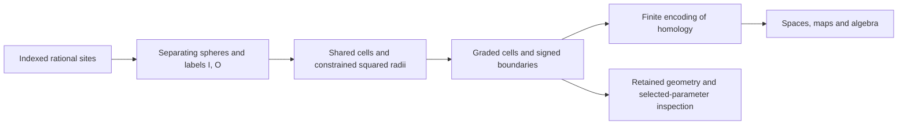

# Exact rhomboid multicover construction

A location covered by two growing balls first appears when those balls meet.
For sites at $(0,0)$ and $(2,0)$, this happens at physical radius one. At depth
one, the same event merges the two components. A useful finite model must
preserve both observations and the maps connecting different radii and depths.
Drawing the balls or building a graph at one radius does not supply those maps.

TamerOp constructs a graded cellular complex and can then encode its homology
over a finite parameter poset. The geometric inspector retains that same
complex before encoding, with its source labels and geometric vertices. This
account explains how the native construction gets its cells, radii and maps,
and how inspection preserves the distinction between that finite object and
a picture of it. The [multicover guide](../tutorials/multicover.ipynb) develops
the two-site example and a degenerate square through executable figures.

## From spheres to cells

A separating sphere partitions the indexed sites into an inside set $I$, an
on-sphere set $O$, and the remaining outside sites. The native cell is labelled
by $(I,O)$; its dimension is $|O|$. Under the general-position hypothesis,
the independent on-sphere directions form a cube combinatorially. A face moves
one site from $O$ either into $I$ or into the outside set. Labels, rather than
spatial closeness, determine when two such faces are the same cell.

This is the rhomboid model of
[Corbet, Kerber, Lesnick and Osang, Section 4](https://arxiv.org/html/2103.07823v3).
Its vertices correspond to subsets $S$ with $I\subseteq S\subseteq I\cup O$.
The inspector uses the coordinates

$$
v_S=\left(\sum_{i\in S}a_i,\ |S|\right).
$$

The final coordinate is positive depth; reflecting its sign gives the usual
negative-depth convention. In particular, planar source data have a
three-dimensional lifted cell model. Dropping the last coordinate projects
the drawing; it does not restrict the complex to a depth. Nor is the sum of
sites a barycentre: dividing it by depth would change this geometry.

The exhaustive route enumerates affinely independent supports of size one more
than the affine dimension. Circumsphere equations and classifications use
rational arithmetic in the original Euclidean metric, including when the
cloud lies in a lower-dimensional affine subspace. Faces are inserted
recursively and shared by their labels. Extra cospherical sites in relevant
geometry violate the native contract and cause an explicit error; the code
does not choose an arbitrary diagonal or perturb the input.

The alternative incremental discovery route recovers higher-order subset
labels through weighted lower hulls, following
[Edelsbrunner and Osang, Algorithm 1](https://arxiv.org/abs/2011.03617).
It uses rational CDD hull reconstruction and feeds the same cell/radius stage.
It supports affine dimensions zero through three; exhaustive discovery is
dimension generic. Its hull rebuilding is not a dynamic-hull complexity claim.
Backend eligibility and the automatic selection rule belong beside the
user's choice in the guide; changing that rule does not change the shared
cell representation.

## A birth radius is a constrained minimum

For a fixed cell label, a sphere must keep every inside site inside and every
outside site outside while touching its on-sphere sites. Its smallest radius
is not always the circumradius of $O$ alone. That unconstrained minimizer may
violate another site's inequality. At a constrained optimum, an additional
inequality can become tight, placing the minimizer on a coface's sphere.

The implementation works from higher-dimensional cells downward. It accepts
the unconstrained circumradius when its exact site classification is feasible,
and propagates each coface's minimum to its faces, taking the least feasible
squared radius. The empty anchor vertex has radius zero. A missing realizing
coface is an error, not a zero-radius fallback.

Squared radii stay rational throughout this stage. Only when grades are emitted
does the constructor take an exact algebraic square root. A value such as
$r^2=2$ therefore becomes $r=\sqrt2$, with equality preserved at the birth
event. Finite float inputs mean their exact binary rational values. A radius
cutoff is squared after exact conversion, avoiding a preliminary floating
multiplication. The inspector reports both physical radius and squared birth
radius but always selects the original physical-radius filtration.

## Incidence, windows and finite encodings

Ordering the on-sphere sites fixes the cubical orientation. The two facets
obtained by removing a given direction receive opposite signs, with alternating
sign across directions. Shared faces have one column/row identity. Integer
boundary matrices consequently support any admitted coefficient field; a
drawing's polygon orientation is not used to recompute these coefficients.

An explicit simplex-tree request changes the representation. Unsliced cubes
use a consistent Freudenthal triangulation: chains of subset vertices follow
all orders of adding on-sphere sites, and shared faces have the same global
vertex labels. Bounded-depth cells instead use flags in their actual face
poset, with each flag inheriting its largest cell's grade. These subdivisions
can contain many more simplices. The canonical graded-complex, encoding and
geometric-inspection paths keep the cellular representation.

In the unsliced model, a cell has grade $(\rho(I,O),|I|)$. Radius increases and
depth decreases. For a bounded depth window, the owner constructs horizontal
sections at integer depths and closed slabs between them. It slices carriers
**before** applying a dimension cutoff: a higher carrier can contribute an
essential lower-dimensional terminal cap. The
[depth construction](../rhomboid_depth.md) explains the slab signs and cap
attachment in detail. The two-site window $(1,1)$ retains the edge that merges
the components at radius one, even though no positive-width slab survives.

Once grades and boundaries are fixed, increasing radius or decreasing depth
includes an existing subcomplex. These inclusions induce the maps of the
persistence module. Encoding organizes those spaces and maps over the chosen
finite grid; the geometric viewer itself does not materialize that encoding.
Custom encoding axes may floor-snap births. A snapshot of the retained complex
uses its unsnapped grades, so comparing it with a coarsened encoding requires
accounting for that explicit change of filtration.

## Retaining geometry without changing the model

`filtered_complex` requests geometry from the same constructor that emits the
graded complex. Native cells retain $(I,O)$, their squared radius and any
section/slab identity. Section vertices are the lifted subset vertices at the
retained integer levels. Two-dimensional faces are ordered by walking their
actual edge incidence, using exact vertex equality. No numerical convex hull
or nearest-neighbour reconstruction supplies the boundary.

The degenerate `:subdivision_cech` backend instead emits simplices whose
vertices are labelled subsets and whose simplices are strict inclusion flags.
Inspection retains those exact flags. Its displayed subset barycentres and
cardinalities form a **schematic** layout, which need not be injective. Two
diagonals of a square have the same barycentre; repeated labelled sites also
coincide. Their cell identities and boundaries remain separate. The
subdivision model's relation to multicover is developed in
[Blumberg and Lesnick, Section 4](https://arxiv.org/html/2010.09628v3);
it is not a degenerate native rhomboid tiling.

The natural equivalence to multicover follows from the diagrammatic
subdivision-Cech argument of
[Blumberg and Lesnick, Theorem 4.13 and Remark 4.14](https://arxiv.org/html/2010.09628v3).
The closed-cover hypotheses hold for finite intersections of closed Euclidean
balls, including singleton intersections at exact birth radii: nested closed
convex sets have the homotopy extension property. See
[Bauer, Kerber, Roll and Rolle, v6, Theorem 5.9(1b), Corollary 5.16 and Proposition 5.19](https://arxiv.org/pdf/2203.03571v6).
For repeated sites, the cover and its intersections remain **indexed by label
subsets**, even when their geometric sets coincide. The same union-of-labels
comparison then applies; deduplicating those indices would change coverage.
At depth zero the empty subset supplies the cone and the comparison with the
ambient space. The resulting equivalence respects maps in both parameters.
The native rhomboid comparison is developed by
[Corbet, Kerber, Lesnick and Osang](https://arxiv.org/html/2103.07823v3); the
[bounded-depth guide](../rhomboid_depth.md) gives the explicit terminal attachment.

The source panel evaluates closed-ball membership at displayed sample points.
It counts indexed balls with exact squared-distance comparisons. Its raster
can miss a thin or singleton intersection, so it is never fed into homology.
For higher-dimensional source data it evaluates an explicit spatial section;
circle outlines are sphere sections, while site markers are projected.

At a selected parameter, the algebra uses the active submatrices of the
retained boundaries. Over the chosen field,
$\beta_d=\dim C_d-\operatorname{rank}\partial_d-
\operatorname{rank}\partial_{d+1}$. Display budgets only omit drawn cells.
Independent algebra budgets reject oversized rank/reduction requests. Fixed
depth barcodes use the earliest allowed radius of each retained cell and its
same boundary column. A finite radius cap censors surviving endpoints; it
does not establish essential classes in the uncapped problem.

## Reuse and where the work grows

Exact geometry is cached by coordinate contents and shape, backend request,
and depth window. Radius cutoffs, output skeletons, fields and homological
degrees can reuse compatible carriers. Returned geometry and complexes own
their mutable arrays; filtering a result does not alter the cached carrier
data. Repeated notebook calls use one `SessionCache` explicitly. Budgets are
checked again on cache hits, including recorded construction workspace peaks.

Exhaustive discovery enumerates support combinations and their faces. The
incremental route trades that search for exact weighted hull work. Both can
spend substantial time in rational predicates and constrained-radius
propagation. Flag subdivision can grow exponentially even on a small cloud;
its explicit cell budget is essential. Inspection adds retained vertex storage,
linear activity scans and source-sample distance queries; algebraic ranks and
ordinary reduction can dominate those costs. A selected cell or a display
budget does not reduce the mathematical complex behind a requested invariant.

Optimization belongs at those separate stages, preserving their contracts:
labels and signs for geometry, exact event order for grades, and the declared
field for algebra. Measurements of backend choices belong in versioned
benchmark reports rather than being inferred from the number of drawn cells.

See the [implementation bibliography](references.md#rhomboid-and-multicover-constructions)
for the mathematical and algorithmic sources.
