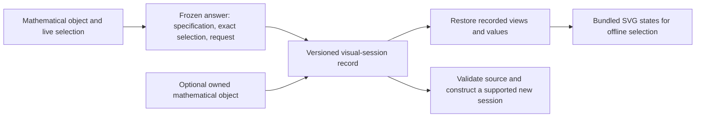

# Serialization, interchange and mathematical provenance

Returning to a saved analysis raises two different questions. Can we recover
the mathematical object and ask another question of it? Can we recover the
particular answer, coordinates and view that someone shared? A persistence
diagram, an encoded module and a selected figure retain different information,
so one generic screenshot or numerical table cannot answer all three needs.

TamerOp uses owned schemas for mathematical artifacts and a separate
declarative schema for saved views. This account follows an encoded module
and an ordinary diagram through those boundaries. The
[live-inspection guide](../tutorials/live_inspection.ipynb) shows the user
workflow; the [session reference](../src/reference/visual_sessions.md) gives
its precise saving and restoration contracts.

## Preserve the object required by the next query

An encoding contains a finite poset, its module and the assignment from
original parameters to finite labels. Keeping only the dimensions loses the
structure maps; keeping only a finite module can lose the original-parameter
assignment. The owned encoding schema retains a fringe presentation over the
finite poset and, when requested, its supported classifier.

On loading, the finite module is reconstructed as the image of that
presentation. This recovers the represented module up to natural isomorphism.
It need not recover the exact bases used by the original computation.
Coordinate semantics and mathematical provenance retain the recorded field,
degree, orientation, window, discretization and approximation conventions.
They describe the computation that produced the object; they do not prove
that a discretization or approximation represents some larger unstored object.

An ordinary persistence diagram follows its own owned schema. It retains
finite and essential intervals in each degree, grade types and values,
coefficient field, order and available provenance. Requested cycles, fillings,
cocycles, landmark records and source correspondences travel with the result
when they were retained. Endpoints alone do not recover those choices.

The diagram loader checks the reconstructed result against its header and
validates retained source correspondence and boundary equations where that
data is present. It does not recompute the entire persistence problem from an
absent input. The [source-representative account](source_representatives.md)
explains which equations establish a claimed source lift.

## A coordinate matrix needs more than an isomorphism class

Suppose a selected map from $\mathbb Q^2$ to $\mathbb Q$ has matrix

$$
A=\begin{bmatrix}1&2\end{bmatrix}.
$$

If the source basis changes by
$S=\begin{bmatrix}1&1\\0&1\end{bmatrix}$ while the target basis stays fixed,
the same map is displayed as
$AS=\begin{bmatrix}1&3\end{bmatrix}$.
Both matrices have rank one, but they are different selected readouts.

For this reason a saved visual source for an encoding supplements its owned
encoding payload with the original finite module's dimensions and maps in
their stored coordinates. The classifier still answers original-parameter
questions, while the retained module coordinates let a resumed inspector use
the same basis convention as the saved figure. A plain finite module has the
same coordinate-retention requirement without a classifier.

Module loading validates matrix shapes, coefficient fields and independence
of the chosen cover path. For an encoding, the coordinate module and fringe
also have to agree on their labelled poset, field and stalk dimensions.
These checks do not construct a new natural isomorphism between independently
edited fringe and module declarations. The artifact preserves the compatible
data produced by the supported save path; its loader is not a general
equivalence prover for arbitrary replacement presentations.

Resumable frames carry the content identity of their complete original source.
Attaching an object checks this identity and replays each supported request
against that source, comparing the selected answer and prepared view. This
joins the frozen answer to the declared source without claiming to prove that
two independently supplied encodings are naturally isomorphic.

This is also why a content identity is not an isomorphism certificate. Two
artifacts can describe isomorphic mathematics and have different recorded
coordinates, provenance or bytes. The saving boundary identifies the retained
content it promises to restore, rather than attempting a general module
isomorphism test.

## Encode exact values as typed data

The JSON number syntax alone does not express every relevant value. An exact
rational must keep its numerator and denominator; an algebraic radius must
keep the algebraic number rather than a rounded drawing coordinate. The
owned scalar codecs therefore retain explicit tags and representations.

| Value | Retained information |
| --- | --- |
| Integer | Its supported integer type and decimal value |
| Rational | Its rational type and exact numerator/denominator representation |
| Real algebraic number | Defining polynomial and real-root index |
| Floating value | Its type, value and precision, including custom `BigFloat` precision |
| Coefficient field | Rational or prime-field identity, or a real field's numerical tolerances |
| Array or sparse matrix | Element type, shape and entries; sparse storage keeps its index structure |

The declarative visual codec extends these values with a closed set of visual
records: layers, specifications, styles, contexts and annotation anchors.
Named tuples, tuples, dictionaries and supported array types provide the
surrounding data. Constructors come from a fixed allowlist. A serialized type
name is never interpreted as arbitrary Julia source.

Decoding validates tags, field sets, type parameters, dimensions, array lengths
and sparse-index consistency before accepting the corresponding object. It
also bounds nesting and visited entries. These limits bound record complexity;
the bit size of an exact coefficient and the cost of constructing an algebraic
number remain separate concerns.

## Save a selected answer independently of its live source

The visual-session schema stores named states and an initial state. Each state
contains its static visual specification, exact selection and declarative
request. The collection records a shared style and figure size separately;
these are save options, not a measurement of the original renderer's state.
Captions and context identify what the figure claims to show.
Mathematical values remain separate from their numerical drawing positions.

*The retained answer is independently usable. Resuming computation additionally
requires a supported mathematical source and a validated reconstruction route.*

Not every value in runtime metadata belongs in a portable artifact. Caches,
locks, callbacks, rendering handles and arbitrary owner objects cannot be
recreated from a descriptive label. The snapshot conversion reports omitted
opaque metadata and retains the supported declarative values. A retained
callable's last computed answer may be data; the callable itself is not.

Including an object is explicit. Without that opt-in, the artifact remains
sufficient for its recorded states and values, but it does not promise new
queries. Ordinary diagrams reuse the existing owned diagram schema rather
than a weaker endpoint-only copy. Supported finite modules and encodings
retain the coordinates described above. No runtime caches or listener
subscriptions are serialized.

## Check referenced resources at the point where they are needed

A session can refer to an owned artifact stored under its bundle directory.
The record uses a portable relative path and a SHA-256 content identity.
Moving the complete directory preserves the relationship. An absolute path
into the author's machine would not provide that portability.

The source reference is not needed to display a retained snapshot. A recipient
can therefore inspect the recorded answer even when its optional source is
unavailable. Live restoration resolves the resource, checks its identity and
loads it through the relevant owned-artifact path. A missing or changed
resource rejects that new computation; it cannot silently substitute another
mathematical object beneath the old selection.

Relative-path validation keeps the reference inside the declared bundle.
Content checks detect changes to the referenced artifact. Neither mechanism
asserts that a file's mathematical claims are true: strict owner validation
and the meaning of the retained provenance remain necessary.

## Distinguish reconstruction from rendering

Loading session JSON recovers its inert record. Loading saved-session HTML
extracts that same embedded record; it does not execute the page's browser
program. Rendering in Julia uses the stored specification and style through
the regular visual backend. Live restoration separately constructs the
supported inspector and applies its validated selection.

HTML export prepares SVG for every retained state and bundles the session
record and plotted-value downloads. The exact record remains available even
though the SVG uses numerical positions. Authored and previously checked
composition connectors keep their distinction, with their frozen coordinates
and recorded evidence. Loading a picture does not recertify a changed source.
The [inspection-session account](inspection_sessions.md) explains how offline
state selection differs from browser events backed by Julia.

Exporting one saved state to SVG, PNG or PDF also prepares a companion JSON
record by default. The companion retains the selected answer's exact available
values, caption, provenance and original source identity, with the image's
filename and SHA-256 digest. It can reopen as a static snapshot independently
of the image, but contains no full mathematical source or live reconstruction
request. `sidecar=false` omits that record. Export to HTML similarly retains
the selected state and original source identity without copying the original
mathematical object into the figure export.

The image and its record are both prepared before replacement. Their individual
file replacements are atomic; replacing two files does not constitute a
filesystem transaction. Stored style and size are reused by the saved-session
export overloads. The specification's declared axes survive, while a renderer's
transient camera, pan and zoom are not part of the captured data.

Storage grows with the sum of retained state data and rendered SVG, plus any
included mathematical source. Identifying a resumable source serializes its
complete supported mathematical content and can materialize a lazy module;
attaching the source also replays its selected requests. Sharing a source
object does not eliminate the cost of several large snapshots or these checks.
Reopening a static state avoids the original
mathematical query, while resuming can repeat preparation and selection work
because runtime caches were deliberately excluded.

## Owned artifacts and external interchange have different contracts

Owned loaders recognize TamerOp's versioned records and validate their stated
schema. External adapters instead interpret a declared exchange convention
from another producer. Importing such a convention can supply useful
mathematical data without supplying TamerOp's selected states, source
identities or provenance. A figure export likewise preserves what it draws,
not every operation available on its original source.

Keep these boundaries visible when choosing an output. JSON for a mathematical
result, JSON for a selected session, an offline HTML collection and a numerical
feature table solve different preservation problems. Their common use of a
file or a JSON container does not make their guarantees interchangeable.

## Retaining an authored draft

An editor snapshot can carry declarative order, dimensions, support memberships
and coefficient matrices even when they fail a mathematical relation. The
owned value codec records these typed values and the validation readout as
snapshot metadata. This is a draft, not a serialized unchecked `PModule`.
`module_editor(saved)` runs normal input validation again and starts a fresh
history. Julia source export is a separate operation on a valid open draft;
loading a saved view never evaluates that source. The
[session account](inspection_sessions.md#keep-a-draft-distinct-from-a-mathematical-object)
explains this boundary.

## Implementation locations

| Concern | Source |
| --- | --- |
| Exact coordinate representations | [`coordinates.jl`](../../src/serialization/coordinates.jl) |
| Owned finite encoding schema and reconstruction | [`owned_encodings.jl`](../../src/serialization/owned_encodings.jl) |
| Ordinary result schema and retained data | [`owned_persistence.jl`](../../src/serialization/owned_persistence.jl) |
| Allowlisted visual values and structural validation | [`owned_visual_values.jl`](../../src/serialization/owned_visual_values.jl) |
| Source coordinates and canonical content identities | [`owned_visual_sources.jl`](../../src/serialization/owned_visual_sources.jl) |
| Versioned envelope and relative resources | [`owned_visual_sessions.jl`](../../src/serialization/owned_visual_sessions.jl) |
| Portable HTML presentation | [`session_html.jl`](../../src/visualization/session_html.jl) |

[Bibliography](references.md).
