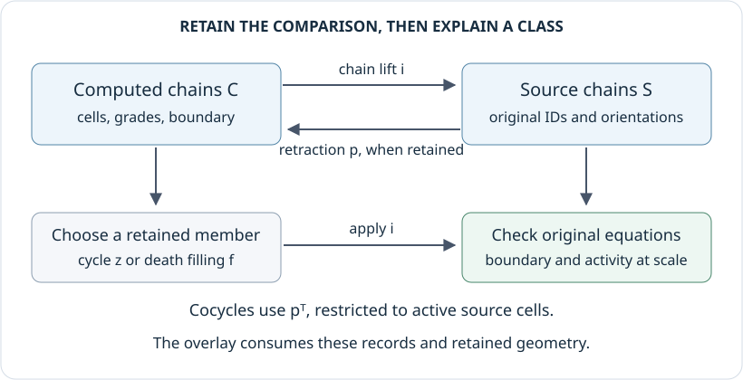

# Retaining representatives and tracing them to source cells

A persistence interval tells us when a class exists. To express that class on
an input image or point cloud, we need a cycle in the computed cell basis and
a map from that basis to the source cells. Geometry then lets us draw the
result. Interval endpoints alone do not determine any of these choices.

This account follows that map from construction to a source query. The
[source cells guide](../tutorials/source_cells.ipynb) develops the examples and
pictures, while the [reference](../src/reference/source_representatives.md)
gives the calling contracts. Ordinary persistence uses these maps when source
retention is requested. A supplied complex with several parameters can use the
same operations at a chosen parameter without first computing a barcode.

## Keep the cells and their correspondence

A `FilteredComplex` retains the cells, their integer boundaries, appearance
grades, source identities and geometric vertices. For a cubical cell, its
identity records an origin and the coordinate directions in which it extends;
for a simplex, the identity is an ordered tuple of source vertices. Coefficient
vectors number cells within a single dimension, while the complex viewer
numbers all vertices, then all edges, and so on. The conversion uses these
dimension offsets, so it depends on the cell basis even when two cells occupy
the same place in a drawing.

Let $C$ be the computed chain complex and $S$ the source chain complex.
A `SourceCorrespondence` retains a chain map $i:C\to S$. A chain map is a family
of linear maps, one in each degree, that commutes with taking boundaries. When
available, a second chain map $p:S\to C$ satisfies $pi=1_C$ and is called a
*retraction*: mapping a computed chain to the source and back recovers it.
Both maps are stored as sparse matrices over an exact rational or prime field.
Ordinary persistence uses prime fields; direct queries on supplied complexes
can also use rational coefficients.

A `SourceChain` is a resulting chain or cochain at one parameter, with its
field, source identities and geometry. The boundary matrices determine the
oriented cell basis. Projecting coordinates for a picture or printing a residue
modulo a prime does not change that basis.

[](../assets/implementation/source_representatives.svg)

The cycle and filling follow $i$ toward the source. A cocycle follows the
transpose of $p$, because it evaluates chains arriving from the source.
[Open the diagram at full size.](../assets/implementation/source_representatives.svg)

An ordinary diagram stores the correspondence when the caller supplies one or
requests `source=true`. The flags `representatives=true` and `cocycles=true`
retain their respective reduction data independently. A computation requesting
only intervals avoids these storage costs. Retaining source cells requires an
explicit complex, which can use more memory than a Rips reduction that generates
simplices only as needed.

## Why the maps preserve cycles

Write $\partial^C_d:C_d\to C_{d-1}$ and
$\partial^S_d:S_d\to S_{d-1}$ for the boundary maps in degree $d$. The chain map
condition is

$$
\partial^S_d i_d=i_{d-1}\partial^C_d.
$$

If $z\in C_d$ is a cycle, its source boundary is therefore
$\partial^S_d(i_dz)=i_{d-1}(\partial^C_dz)=0$. If a chain $f\in C_{d+1}$
fills it, so that $\partial^C_{d+1}f=z$, the same equation gives
$\partial^S_{d+1}(i_{d+1}f)=i_dz$. These equations explain why the lifted filling
bounds the lifted cycle. The implementation checks them over the declared
field, including signs that disappear over $\mathbb F_2$ but matter over an
odd prime field.

The maps must also respect the filtration. Whenever a domain cell is present,
every cell with a nonzero coefficient in its image must be present. A cell
with several appearance grades is active in the union of the corresponding
upper sets, using each coordinate's declared order. Checking every appearance
grade of each domain cell establishes this condition throughout the filtration;
checking one convenient parameter would not.

An explicit lift may be any filtered chain map. If a retraction is supplied,
the equation $pi=1_C$ additionally makes $i$ injective on chains and homology:
applying $p$ to an image recovers the original class. This still allows extra
source classes outside the image. The automatic contraction below establishes
the stronger conclusion that the complementary source cells contribute no
homology.

## Recover a retraction after removing cells

For a computed subcomplex, matching exact source identities first gives an
inclusion in the original selected model. Its signed boundaries must agree
with the source boundaries. Sampling and sparsification already determine this
model; recovering cells removed by a collapse does not recover discarded points
or edges omitted before the collapse.

To construct the retraction, the algorithm cancels complementary cells in
pairs with equal sets of appearance grades. Suppose an extra cell $b$ has an
extra face $a$ with invertible boundary coefficient $u$. In a boundary matrix
$D$, the column $D[:,b]$ describes the boundary of $b$, and the row $D[a,:]$
describes the coefficients of $a$ in all boundaries. Eliminating that pair
updates the remaining entries by

$$
D'=D-D[:,b]u^{-1}D[a,:],
$$

followed by discarding the canceled row and column. This matrix operation is a
Schur complement. The accumulated projection onto the remaining chains is
updated by the same cancellation. Because the target cells form a subcomplex,
the projection fixes them pointwise. Equal appearance grade sets keep the
cancellation valid at every parameter, including when some grades are
incomparable. If complementary cells remain with no admissible cancellation,
construction requires explicit maps instead of assuming that equal barcodes
supply a correspondence.

For a small signed example, start with the filled triangle $[1,2,3]$ and retain
the path with edges $[1,2]$ and $[2,3]$. Removing the face and edge $[1,3]$ gives
a retraction with

$$
p[1,3]=[1,2]+[2,3],\qquad p[1,2,3]=0.
$$

The triangle boundary is
$[2,3]-[1,3]+[1,2]$, so its image under $p$ is zero, as required by the chain
map equation. A cochain taking values $(1,0)$ on the path edges evaluates an
original edge by first applying $p$. On the ordered source edges
$([1,2],[1,3],[2,3])$, its values are consequently $(1,1,0)$. Applying it to
the triangle boundary gives $0-1+1=0$ over every supported prime field.

The ingestion collapse detector uses filtration domination of flag graphs;
see [Alonso, Kerber and Pritam](https://arxiv.org/abs/2211.05574). The matrix
contraction described here is a further package computation on the explicit
complexes. The graph detector itself does not supply these lifting matrices.

## Check a cycle, its filling and a cocycle

An ordinary cycle query uses the requested parameter, or birth when none is
supplied. A finite death filling uses the death parameter. Its equation
$\partial f=z$ links the two records even when the filling's cells were absent
at the earlier parameter. Changing the reduction order can
change the chosen cycles without changing the barcode.

A cochain evaluates chains. Given a computed cocycle $\alpha$, its source
value on a chain $s$ is $\alpha(ps)$, so its coordinate vector is
$p^*\alpha=p^{\mathsf T}\alpha$. This is the contravariant direction: the
cochain moves opposite to the map $p$ on chains. The lift $i$ has the wrong
direction for this operation. The implementation restricts the returned
cochain to active source cells and checks that it evaluates to zero on every
active boundary. Homology and cohomology reductions choose their bases
independently, so equal interval member indices do not establish dual bases.

These checks use boundaries and grades before converting coordinates for
drawing. A periodic edge can have zero boundary even though its two endpoints
look distinct in a planar fundamental domain: those endpoints are identified.
The drawing preserves that seam. Higher dimensional chains remain available
as algebraic records, while source overlays draw degrees zero through two.

## Recover connected components from their merge history

For degree zero, the source vertex and edge incidences determine component
membership. `component_history` orders edges by their exact entry parameters
and maintains a partition of the vertices, joining the two parts whenever an
edge connects them. This partition algorithm is commonly called *union-find*.
The older component birth keeps its label, with source vertex order breaking
equal birth ties.

A separate binary forest records each joining edge and its parameter, with
the two former components as children of a merge node. An edge whose endpoints
are already joined creates no merge, nor does a periodic loop with zero
boundary. Several nodes may have the same parameter when edges enter together;
their reproducible binary order does not introduce distinct event times.

A query cuts this forest after all events at its parameter. Counting the
remaining components does not require listing their vertices. A membership
query follows each selected branch to its vertex leaves. The forest therefore
uses space linear in the number of source cells, while storing a complete
member list at every merge could use quadratic space. Following a birth vertex
after its bar has died returns the current descendant component and records
that the original bar is merged.

For several parameters, first choose an affine slice $b+tv$, where $b$ is the
base point and $v$ its direction. Let $o_j$ be $1$ for a sublevel coordinate
and $-1$ for a superlevel coordinate. We require $o_jv_j>0$ in every coordinate.
A cell with appearance grade set $G$ enters at

$$
t_{\mathrm{entry}}=\min_{g\in G}\max_j
\frac{o_j(g_j-b_j)}{o_jv_j}.
$$

For one grade, the maximum is the first time every coordinate has reached
that grade. Taking the minimum over grades implements the rule that any one
appearance suffices. The resulting merge forest belongs to this slice. When
a source correspondence is supplied, the operation additionally compares
source and computed degree zero interval multisets before returning source
memberships; equal intervals alone cannot identify individual reduction choices.

## Minimize support within one homology class

At a fixed parameter, all cycles homologous to $z$ have the form
$z+\partial_{d+1}f$. Choose independent columns of the active boundary matrix
and put them in $B$. If $B$ has rank $r$ over $\mathbb F_p$, its image contains
exactly $p^r$ vectors. The optimizer checks that $z$ represents a nonzero class,
checks this number against the candidate budget, and enumerates the image.

For nonnegative cell weights $w_j$, the objective is

$$
\min_{x\in z+\operatorname{im}B}\sum_{j:x_j\ne0}w_j.
$$

Only nonzero support contributes: the weight does not measure coefficient
magnitude. Integer and rational weights remain exact, while floating weights
are compared as their represented binary rational values. The result retains
the original chain and a chain $f$ satisfying $x-z=\partial f$. This certifies
that the nonzero homology class is unchanged.

Changing the parameter can change the available boundaries, so the minimum
belongs to the declared parameter and finite source model. The enumeration
has exponential cost and a hard candidate budget. Ordinary drawing and
selection do not invoke it.

## Explain a transition between sampled parameters

A parameter atlas asks which classes survive from a declared parameter $p$
to a comparable parameter $q$. On a retained filtered complex, each cell has
the same identity at both parameters. Appearance grades and coordinate orders
determine which cells are active before any drawing coordinates are computed.

In degree $d$, restricting the source boundary matrices to active cells gives

```math
C_{d+1}(p) \xrightarrow{D_{d+1}(p)} C_d(p)
\xrightarrow{D_d(p)} C_{d-1}(p).
```

Homology is $\ker D_d(p)/\operatorname{im}D_{d+1}(p)$. The computation chooses
cycle columns $Z_p$ representing a basis of this quotient. A sparse matrix
$I_{pq}$ sends each active source cell to that same cell at the target.
Expressing $I_{pq}Z_p$ in the target homology basis gives the induced map
$A_{pq}$. These endpoint bases remain fixed for every pair, so map compositions
can be compared by matrix multiplication.

For the ring followed by its filled center, degree one dimensions are one
and zero. Thus $A_{pq}$ has zero rows and one column. A vector $v$ in its kernel
lifts to the source cycle $z=Z_pv$. Because this class maps to zero, a target
chain $f$ satisfies

```math
D_2(q)f=I_{pq}z.
```

With witnesses requested, the implementation solves this equation, checks it
over the exact field and retains both chains in full source coordinates.
For a cokernel witness, it extends the image columns of $A_{pq}$ to a basis of
the target coordinate space, then lifts an added vector through $Z_q$. That
cycle represents a target class outside the image. Neither construction chooses
a minimum support representative or a canonical decomposition into classes.

The list of entering cells answers a different question. All cells at the
same grade enter before homology is computed, so an edge and triangle appearing
together can leave no surviving loop. Conversely, a loop can appear and fill
strictly between two sampled parameters, leaving no trace in their endpoint
map. The atlas describes its declared states and comparisons without assuming
that they include every filtration event.

For a finite module, the atlas obtains maps directly from the module. For a
planar encoding, it first checks comparability of the original parameters and
then queries the corresponding finite map. Incomparable parameters can share
a finite label, so label equality alone does not supply an ambient map. These
inputs provide coordinate kernel and cokernel witnesses, but do not supply
source cycles unless a source correspondence is retained.

Construction stores all ordered endpoint maps, including nonadjacent
composites, and computes source homology at most once per declared state.
Selections then reuse these records. Limits on states, ordered pairs, input
cells and estimated algebra entries are checked before construction. The
source homology workspace estimate is quadratic in the retained cell count;
an entry count does not bound exact coefficient sizes. The
[inspection account](inspection_sessions.md#reuse-a-declared-atlas) explains
how live and saved views use the resulting records.

The computation lives in
[`parameter_atlas.jl`](../../src/visualization/parameter_atlas.jl) and uses the
homology coordinate and particular solution operations in
[`ChainComplexes.jl`](../../src/ChainComplexes.jl). The
[rational coordinate account](qq_coordinates.md) explains those exact quotient
coordinates and membership checks.

## Storage and repeated queries

Source retention stores cells, geometry and sparse maps in addition to the
requested reduction columns. The uncollapsed source may be much larger than
the reduced model, and cancellation can turn zero matrix entries into nonzero
ones, increasing sparse storage. Repeated queries reuse the verified
correspondence; its retained arrays must remain unchanged. A selection snapshot
keeps its chosen interval member and does not compute missing representatives.

The persistence format stores sparse map entries, source boundaries, grades,
identities and geometry. Loading checks the map equations and recomputes
automatic contraction certificates. It checks retained cocycles at every source
appearance parameter within their interval, rather than only at birth. This
cost is part of retaining interpretable source results and exceeds that of
loading endpoints alone. The data codec rejects unsupported callback metadata,
so a saved diagram contains data rather than executable callbacks.

See the [implementation bibliography](references.md) for related algorithms.
