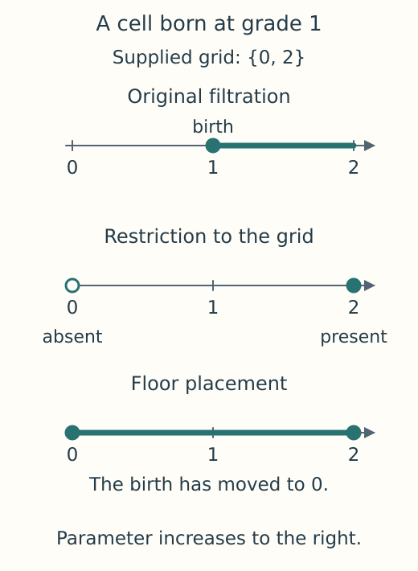

# Ingestion options and their mathematical effects

A filtration tells us when cells appear, with every boundary present by the
time its cell appears. To compute a persistence module from it, we choose a
coefficient field and a homological degree, then organize the resulting spaces
and maps on a finite parameter grid. Some options change that represented
module; others change how its data are stored. Understanding the distinction
helps when two computations are meant to answer the same question. The
[finite encoding introduction](finite_encodings.md) explains how the finite
model relates to the original parameters.

## Grades, orientation and the parameter grid

`PipelineOptions` controls the passage from a constructed filtration to an
encoded module. A sublevel coordinate includes cells whose value is at most a
threshold. A superlevel coordinate includes cells whose value is at least it, so
the direction of inclusion reverses. The `orientation` signs are `+1` and
`-1`, respectively; superlevel coordinates are negated to make both directions
increasing in the finite grid. Some geometric families fix these signs to
match their parameter meanings.

The grid needs particular care. Suppose a cell is born at grade 1, but the
supplied axis contains only 0 and 2. TamerOp places its birth at 0, the
preceding grid coordinate. The cell is consequently present at 0 in the new
filtration, whereas restricting the original filtration to those two samples
would leave it absent there. This **floor placement** changes the filtration.
Include every critical grade if the original births must be retained exactly.



*The same two sample coordinates give different answers at 0. The arrows
indicate increasing filtration parameter; filled circles mark presence of
the chosen cell. Floor placement moves its birth to the preceding sample.*

The result provenance records `:floor_snapped` when a supplied or coarsened
grid moves a critical grade in this way. Rounding grades with `eps` is a
separate operation that happens before encoding.

| Control | Effect |
| --- | --- |
| `eps` | Rounds each grade to the nearest multiple of a positive step, shared across coordinates or supplied as a tuple. It changes the filtration, including raw simplex tree and graded complex outputs. |
| `axes_policy=:encoding` | Uses supplied axes when present, otherwise the axes obtained from constructed grades. Quantization preserves explicitly supplied axes. |
| `axes_policy=:as_given` | Requires explicitly supplied filtration axes and uses them. |
| `axes_policy=:coarsen` | Selects at most `max_axis_len` values from each axis, evenly spaced in index. A positive `max_axis_len` is required and is rejected under the other policies. |
| `axis_kind` | Checks for integer typed axes (`:zn`) or noninteger typed real axes (`:rn`), without converting the coordinates. |
| `field` | Chooses the coefficient field through a field object, such as `QQField()`, `F2()`, `Fp(5)` or `RealField()`. An explicit `encode(...; field=...)` takes precedence over the pipeline choice. The default is the rational field QQ. |

At the Julia constructor, orientation signs must be integers. JSON also
accepts exactly integral numbers, so `1.0` and `1` both become `+1`.
Nonintegral numbers, zero, other signs and Booleans are rejected.

## Store the same finite order in different ways

The grid is a product of chains, one for each parameter. Its default
representation keeps that product structure. Dense storage instead records
all comparisons explicitly, using the same vertices and labels. These two
calls therefore give the same spaces and maps over the field with three
elements:

```julia
import TamerOp as OP
points = OP.PointCloud([[0.0], [1.0]])
filtration = OP.RipsFiltration(max_dim=1)
structured = OP.encode(points, filtration;
    pipeline=OP.PipelineOptions(poset_kind=:signature, field=OP.CoreModules.F3()))
dense = OP.encode(points, filtration;
    pipeline=OP.PipelineOptions(poset_kind=:dense, field=OP.CoreModules.F3()))
```

`poset_kind=:signature` selects the structured representation and `:dense`
selects the explicit relation, which can require quadratic memory in the
number of grid vertices. This choice applies to all encoded stages, including
lazy complexes and dimension summaries. The `:regions` option belongs to
other encoding families and is unavailable for ingestion grids.

## Choose how much of the construction to request

The raw stages `:simplex_tree` and `:graded_complex` return cells and grades,
before a finite poset or coefficient field has been attached. A construction
plan may still retain those options for use in a later encoded stage.
`run_ingestion(plan)` uses the stage stored by `plan_ingestion`;
`run_ingestion(plan; stage=...)` selects a different one, while `encode(plan)`
requests the final encoding result. `ConstructionOptions.output_stage` accepts
every executable stage, including `:encoded_complex` and `:cohomology_dims`.

Construction options must apply to the chosen data and filtration. For
example, unsupported sparsification choices are rejected. Budgets apply to
prebuilt complexes, graph and cubical constructions, as well as to point
clouds. A memory budget limits the documented estimate of construction
storage; Julia and its dependencies can use memory beyond that estimate.

## Reuse and save these choices

A session cache distinguishes the order representation, coefficient field and
constructed chain data, so reusing it respects an explicit request to change
any of them. Pipeline JSON schema version 3 stores field objects together
with their prime or numerical tolerances. Replaying a saved pipeline thus
preserves that choice. The strict loader requires version 3; use the writer
to create a compatible file.

When loading tabular data, `header`, `delimiter`, `comment_prefix` and
`missing_policy` apply to CSV, TSV and text formats. `cols` chooses point
coordinates; `u_col`, `v_col` and `weight_col` choose graph columns. A nondefault
option is rejected when the format or dataset kind does not use it. Owned
JSON and Ripser inputs have their own parsers. After loading, configure the
construction when calling `encode`.
