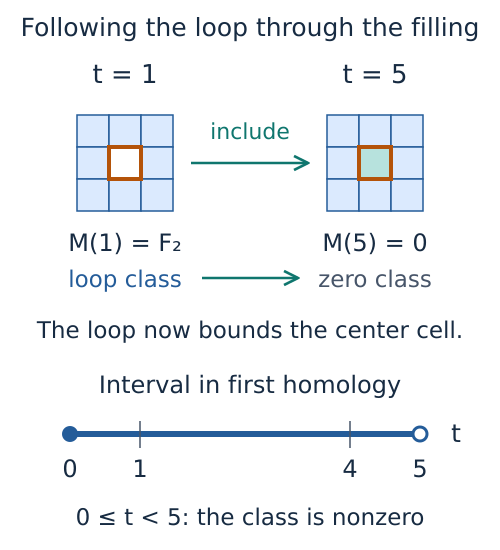
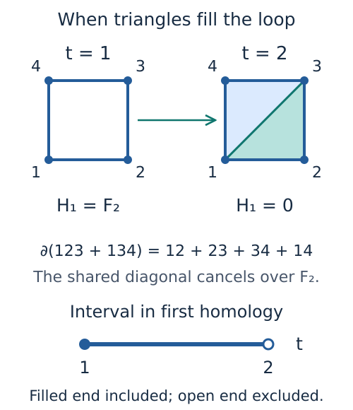

# Ordinary persistent homology

When a shape grows, connected components can merge and holes can appear or
fill in. Ordinary persistence records how long these features survive as one
parameter changes. In the example below, squares appear at their array values:
the boundary squares form a ring at zero, and the center fills its hole at five.

We can predict the first barcode before computing it. The hole is present
at parameter zero and remains until five, so its interval is $[0,5)$. The
left endpoint is included because the ring already exists at zero; the right
endpoint is excluded because the center square is present at five.



*The orange loop is still a chain of edges after the center enters, but it
now bounds a square. Its homology class has become zero. This schematic uses
the field $\mathbb{F}_2$ and the array below; it is the same ring developed in
the [first notebook](tutorials/ring.ipynb).*

```julia
import TamerOp as OP

values = zeros(Int, 3, 3)
values[2, 2] = 5
ring_diagram = OP.cubical_persistence(values)
OP.finite_intervals(ring_diagram; dim=1)       # [(0, 5)]
OP.essential_births(ring_diagram; dim=0)       # [0]
OP.persistence_intervals(ring_diagram; dim=0)  # [(0, Inf)]
```

The returned **persistence diagram** stores intervals in each homology degree.
Degree zero records connected components, degree one records classes of loops,
and degree two can detect enclosed cavities. A **chain** is a formal sum of oriented cells with coefficients in a field,
and a **cycle** is a chain with zero boundary. A homology class identifies
cycles whose difference is the boundary of a chain one degree higher. Here the single component remains
after the hole fills, giving the essential interval $[0,\infty)$ in degree zero.
“Essential” means that the class never dies in the filtration we constructed;
a cutoff on the input can limit what this tells us about a larger filtration.

The default coefficients lie in $\mathbb{F}_2$, the field with two elements.
The direct `persistence_diagram` interface accepts a finite chain complex with
one birth parameter per cell, or constructs one from data and a typed
filtration. Its output is the barcode of that complex; this calculation does
not require a finite encoding. The sections below explain which input and
retention choices change the question or the information available afterward.

Use `OP.describe(ring_diagram)` for a compact account of the result and
`OP.provenance(ring_diagram)` for its field, conventions and computation route.
The exact interval accessors return copies. Degrees are named keywords:
negative degrees are invalid, and a degree above the stored range is empty
unless an explicit `max_homology_dim` request excluded it, in which case the
query raises an error.

## Choosing coefficients

A coefficient field specifies how chains add and cancel. The default F₂ has
only zero and one, so adding an edge to itself removes it. Over F₃, coefficients
are zero, one and two, and reversing an orientation multiplies by two, the
residue of minus one. The existing signed simplicial and cubical boundaries
therefore matter when we change fields.

```julia
import TamerOp.CoreModules: F3, Fp

D3 = OP.cubical_persistence(values; field=F3())
OP.finite_intervals(D3; dim=1)       # [(0, 5)]
D101 = OP.cubical_persistence(values; field=Fp(101))
OP.finite_intervals(D101; dim=1)     # [(0, 5)]
```

The ring has the same interval in these fields, but that need not hold for
other spaces. For example, a cellular description of the real projective
plane has one cell in each of dimensions zero, one and two, with the
boundary of the two-cell equal to twice the one-cell. That boundary vanishes
over F₂. Over an odd prime it is nonzero: if the one-cell appears at one and
the two-cell at two, the class in degree one dies at two. Over F₂ it survives,
and an essential class in degree two appears as well. Changing the field requires
recomputing the diagram; changing a stored field label cannot give this result.

Pass an actual prime field object, such as `F3()` or `Fp(101)`; this direct
interface does not accept field names as symbols, rational coefficients or
floating coefficients. Integer boundary coefficients are interpreted modulo
the selected prime. All prime moduli accepted by `Fp(p)` are supported, including primes up to
`typemax(Int)`. Modular arithmetic avoids machine-integer overflow. The field
contract applies to supplied one parameter complexes, typed ingestion, both
cubical input conventions, sublevels, superlevels and retained representatives.
Grade ordering and endpoint types remain independent of the coefficient field.

## Interval conventions

A sublevel filtration includes cells whose grade is at most the parameter.
Its finite pair `(birth, death)` represents `[birth, death)`: the class exists
at its birth and is absent at its death. Essential classes persist to `Inf`.

A superlevel filtration includes cells whose grade is at least the parameter,
with maps toward decreasing parameters. Its pair `(birth, death)` has
`birth > death` and represents `(death, birth]` in the original numerical
coordinates. Essential classes persist to `-Inf`.

Cells at equal grades are inserted together mathematically. Internal reduction
orders faces before cofaces to break ties, but its pairs of zero length represent
the zero persistence module and are omitted from the returned barcode.

```julia
upper = OP.cubical_persistence(5 .- values; order=:superlevel)
OP.finite_intervals(upper; dim=1)       # [(5, 0)]
OP.persistence_intervals(upper; dim=0)  # [(5, -Inf)]
```

Finite endpoints and essential births retain the supplied grade type, including
integers, rationals, arbitrary precision numbers and exact real algebraic
values. Essential births are stored separately from finite bars.
`persistence_intervals` combines them with an explicit floating infinity marker
without converting any birth or finite death. Use `finite_intervals` and
`essential_births` when exact homogeneous element types matter.

## Cubical inputs and periodicity

`cubical_persistence(values; input=:top_cells)` interprets an array as grades
on its highest-dimensional cells: intervals in 1D, squares in 2D, voxels in
3D, and cubes in any higher positive dimension. A face receives the minimum
value of its incident top cells for sublevels, or their maximum for superlevels.
This gives the union of closed top cells selected at each parameter; voxel
values are not reinterpreted as vertex values.

For example, a shell of low values encloses a cavity until its central voxel
enters. Its two dimensional homology has the interval `[0, 2)`:

```julia
volume = fill(0, 3, 3, 3)
volume[2, 2, 2] = 2
volume_diagram = OP.cubical_persistence(volume)
OP.finite_intervals(volume_diagram; dim=2)  # [(0, 2)]
```

Grades keep their original scalar type, including rational and high-precision
values. Superlevel computations compare in descending order without negating
input values, so unsigned values and the smallest signed integer are supported.

With `input=:vertices`, entries grade vertices. Each cell receives the maximum
of its vertices for sublevels (the lower star), or their minimum for superlevels
(the upper star). Vertex input supports arrays of any positive dimension.
These input conventions describe different filtrations and must be matched
when comparing software.

`periodic=true` identifies both ends of every axis. A tuple of Booleans selects
axes individually. One periodic axis gives a circle factor, including an axis
with a single cell; two periodic axes give a torus. Nonperiodic axes retain their
boundary. Inputs must be nonempty and have finite values.

```julia
torus = OP.cubical_persistence(fill(2//3, 1, 1); periodic=(true, true))
OP.essential_births(torus; dim=0)   # [2//3]
OP.essential_births(torus; dim=1)   # [2//3, 2//3]
OP.essential_births(torus; dim=2)   # [2//3]
OP.check_torus_persistence(torus; throw=true)
```

`check_torus_persistence` checks the diagram and its expected essential counts
`(1,2,1)`. Counts alone do not prove that an unknown source is homeomorphic to
a torus. It returns a report by default; `throw=true` rejects failures. Use
`check_h1=false` or `check_h2=false` only when explicitly checking fewer degrees.

Large volumes contain many more cells than input entries. A nonperiodic
`n₁ × ⋯ × n_d` top-cell array has `∏(2nᵢ + 1)` cells; a periodic axis changes
its factor to `2nᵢ`. Set a construction budget when exploring larger inputs:

```julia
options = OP.ConstructionOptions(budget=OP.ConstructionBudget(
    max_simplices=1_000_000, max_edges=400_000,
    memory_budget_bytes=512 * 1024^2))
volume_diagram = OP.cubical_persistence(volume; construction=options)
```

For cubical input, `max_simplices` counts **all cells**, and `max_edges` counts
one dimensional cells even when their periodic boundaries cancel. Counts and
index overflow are checked before topology enumeration when a budget is supplied.
Both vertex and top-cell memory checks estimate the sparse construction:
topology, cell indices, grades, incident-face entries and assembly workspace.
Vertex input also allows for channel conversion and grade-axis extraction;
it does not charge for hypothetical dense boundary matrices. Periodic faces
count before cancellation, giving a conservative allowance across the cubical
construction routes.
These estimates are not caps on total memory used by the Julia process, persistence reduction, or opt-in
geometry and representative storage. Those can need additional memory.
Cubical sparsification and collapse options are rejected. The same
`construction` option applies to direct and typed vertex input. The separate
`estimate_ingestion` dense-algebra diagnostic still reports potential dense
linear-algebra costs for later encoding work; its strict warning mode can reject
that separate risk.

Use `OP.filtered_complex(volume; construction=options)` to inspect the same
filtered cells without computing homology. Add `source=true` and, separately,
`representatives=true` or `cocycles=true` to `cubical_persistence` when later
questions need chains tied to original cells. Source identities retain the
cell origin and varying coordinate axes, including periodic seams. In one
dimension the geometry is drawn on a line in the plane; higher dimensional
geometry keeps its coordinates for an explicit projection. See the
[guide to source cells](tutorials/source_cells.ipynb) for the retained-chain workflow.

The equivalent typed vertex workflow is
`persistence_diagram(ImageNd(values), CubicalFiltration(periodic=true))`.
Both vertex entrypoints preserve the original grades: a cell receives an
exact maximum or minimum of its corners. Internal ordering indices never
replace or round the reported endpoints. Upper stars also avoid negating
integers at the limits of their range.

For a barcode over $\mathbb{F}_2$ on a nonperiodic array of one, two or
three dimensions, TamerOp can work directly with the rectangular grid without
building every boundary matrix. Periodicity, other fields, higher dimensions,
or a request for source geometry, cycles or cocycles select a route that
constructs the oriented complex. These choices affect the computation and its
storage, while preserving the stated filtration and interval conventions.

```@raw html
<details>
<summary>How the grid calculation uses the geometry</summary>
```

Neighboring cells follow from their positions in the array. The computation
tracks connected components by joining regions. In two dimensions it can
also follow the complementary regions to recover holes; in three dimensions
this recovers cavities, while square boundaries determine the remaining
degree one bars. Small three dimensional neighborhoods can contain features
that appear and disappear at the same grade. Precomputed local boundary
plans eliminate those pairs while retaining their boundary combinations,
so interactions with neighboring regions are preserved.

`OP.provenance(volume_diagram).backend` reports `:f2_cubical_grid` for this
route, with `local_reduction == :relative_tables` in the three dimensional
case. Input grades are ordered exactly and the reported endpoints are
recovered from those original values. The plans are fixed package data;
the array's ranks, connectivity and reduction state belong to this call.
The conservative construction estimate still applies, even when the direct
grid representation needs less storage. It does not limit reduction memory
or the total memory of the Julia process.

Arbitrary supplied complexes receive full boundary and filtration checks.
The grid route uses the cubical boundary identity by construction and retains
the input and budget checks. Typed vertex construction can reuse topology
through its supplied ingestion cache.

```@raw html
</details>
```

## Rips: edges, holes and filling simplices

Suppose four points form a loop. The four edges establish the loop, but they
cannot tell us when it fills in: that requires triangles. A Rips filtration
adds a simplex when all of its edges have appeared, at the largest of their
distances. To compute homology through degree `q`, construct simplices through
`q + 1`. For connected components this means edges; for holes it means
triangles; for two dimensional cavities it means tetrahedra.

`RipsFiltration(max_dim=2)` therefore controls **simplex dimension**. The
ordinary request `max_homology_dim=1` selects **homology degrees zero and one**
and checks that the construction includes the triangles needed for deaths.
An insufficient `max_dim` raises an explanatory error. Queries in degrees above
an explicitly requested maximum also raise an error. Without the homology
keyword, the diagram describes the entire constructed skeleton; its top degree
classes can be artifacts of omitting the next simplex dimension.

A sparse distance matrix lets us supply the edges we actually have. Here four
edges enter at one, and a diagonal enters at two. The diagonal completes two
triangles, which fill the hole:

```julia
using SparseArrays

S = sparse([1, 2, 3, 1, 1], [2, 3, 4, 4, 3], [1.0, 1, 1, 1, 2], 4, 4)
filtration = OP.RipsFiltration(max_dim=2)
rips_diagram = OP.persistence_diagram(S, filtration; max_homology_dim=1)
OP.finite_intervals(rips_diagram; dim=1)  # [(1.0, 2.0)]
```



*The drawings show the clique complex of the supplied graph. The diagonal
closes two triangles, so the loop becomes their boundary. Without those
triangles, the same edge data would leave the loop unfilled. The picture is
a schematic of the matrix example, rather than a claim about the Euclidean
distances in the drawing.*

The matrix dimensions retain all four vertices, including any isolated ones.
A missing stored entry means an absent edge, **not distance zero**. A stored
zero specifies an edge born at zero; dropping stored zeros changes the input
filtration. Either triangle of the matrix is accepted. If both directions are
stored, their values must agree within the symmetry tolerance; the upper
entry determines the distance when they differ within that tolerance. Sparse transpose
and adjoint inputs follow the same rule. Dense matrices require both directions;
positive infinity can denote an absent edge in either representation. Distances
must be nonnegative, diagonal entries zero and all values free of NaNs, with a
`1e-10` tolerance for symmetry and small rounding errors near zero. Construction
uses Float64 distances. These checks do not certify the triangle inequality.
Thus an arbitrary supplied graph defines its weighted clique filtration;
identifying it with a metric Rips filtration requires that interpretation of
the supplied distances. The builder does not fill in missing distances by
shortest paths.

The radius is an inclusive **edge-distance cutoff**. It is not a ball radius
that gets doubled. If we stop the example at one, the filling triangles have
not appeared:

```julia
limited = OP.persistence_diagram(S, OP.RipsFiltration(max_dim=2, radius=1);
                                 max_homology_dim=1)
OP.essential_births(limited; dim=1)  # [1.0]
OP.provenance(limited).window       # (0.0, 1.0)
```

Here the surviving class is essential in the constructed filtration. It is not
proved to survive beyond the cutoff. Barcode and diagram views display this
radius restriction alongside surviving bars. `provenance(limited).rips` records the
input convention, cutoff and simplex/homology coverage. A sparse graph gives
the exact restriction of a larger metric input through a radius only when it
contains every edge at or below that radius; missing distances cannot establish
that completeness by themselves.

`ConstructionOptions(sparsify=:radius)` uses the supplied radius to select
edges. `sparsify=:knn` selects the undirected union of each vertex's nearest
neighbors among available edges, and also respects a supplied radius. Neighbor
selection generally changes the filtration; it is not a certificate that all
Rips bars are preserved. The same graph selection and optional certified
edge-collapse machinery serve sparse and dense distance input. Set limits with
`ConstructionOptions(budget=(max_edges=..., max_simplices=...))`. Exceeding a
limit raises an error; construction never drops cells merely to fit a budget.
The existing `memory_budget_bytes` option bounds an estimated dense boundary
footprint, not total process memory. Advanced users can inspect
`OP.DataIngestion.estimate_ingestion(S, filtration)` before construction;
higher dimensional counts are conservative bounds, without enumerating cliques.

## Choosing landmarks and measuring what was omitted

A smaller set of points can make a Rips calculation affordable. We also want to
know how well those points cover the original data. **Landmarks** are selected
original points; their **covering radius** is the largest distance from any
original point to its nearest selected point.

For five equally spaced points on a line, select three landmarks:

```julia
cloud = OP.PointCloud([[0.0], [1.0], [2.0], [3.0], [4.0]])
selection = OP.select_landmarks(cloud; count=3)
OP.landmark_indices(selection)  # [1, 5, 3]
OP.covering_radius(selection)  # 1.0
```

The routine starts at point 1, then repeatedly chooses a point farthest from
those already selected. It keeps this selection order, with ties resolved by
the original index. Distinct input indices remain distinct even if their points
coincide. Here the endpoints come first, followed by the midpoint; every omitted
point lies at distance one from a landmark.

The same subset can now serve the ordinary barcode or the encoding workflow:

```julia
landmarks = OP.LandmarkRipsFiltration(
    landmarks=OP.landmark_indices(selection), max_dim=2)
D_landmarks = OP.persistence_diagram(cloud, landmarks; max_homology_dim=1)
OP.covering_radius(OP.landmark_selection(D_landmarks))  # 1.0
G_landmarks = OP.encode(cloud, landmarks; stage=:graded_complex)
```

`G_landmarks` retains the selected filtered complex for further questions.
Continue `encode` to a module or encoding when those are needed; the direct
barcode call answers the one parameter question without constructing that
additional object. The returned diagram records the selected original indices
and their coverage. `landmark_selection(result)` returns `nothing` if no subset was
selected. Automatic `RipsFiltration(n_landmarks=..., construction=
ConstructionOptions(sparsify=:greedy_perm))` records the same information.
A complete dense distance matrix can replace the point cloud in either route.
Sparse omissions do not supply enough information to measure coverage.

For a finite **metric** input and covering radius $r$, the bottleneck distance
between the full input and landmark Rips diagrams is at most $2r$, using edge
lengths as the parameter. To see where this scale comes from, send each point
to its nearest landmark. If two original points are at distance at most $t$,
the triangle inequality places their chosen landmarks at distance at most
$t+2r$. The resulting simplicial maps, together with inclusion of the landmarks,
give the persistence comparison. This is the bound from the covering radius also
explained in [Ripser.py's landmark tutorial](https://ripser.scikit-tda.org/en/latest/notebooks/Greedy%20Subsampling%20for%20Fast%20Approximate%20Computation.html).

`OP.describe(selection)` includes this **conditional** bound, ordered insertion
radii, and each original point's nearest landmark index and distance. The first
insertion radius is `Inf`, since no landmark precedes it. Matrix validation does
not certify the triangle inequality. This bound concerns full metric Rips
filtrations with the filling dimensions present; it does not certify additional
nearest-neighbor pruning, top degree artifacts of an incomplete skeleton, or
essential bars censored at a finite cutoff. Distances use Float64; numerical
rounding is separate from the mathematical bound.

Coverage needs only linear storage in the input and subset sizes. If a later
calculation needs every landmark-to-original-point distance, retain that larger
table explicitly:

```julia
with_distances = OP.select_landmarks(cloud; count=3, retain_distances=true)
OP.landmark_distances(with_distances)  # 3 rows (landmarks), 5 columns (input points)
```

Rows follow selection order and columns retain original point order. Supplying
`indices=[5, 1, 3]` instead of `count=3` inspects that particular ordered subset.
The coverage result owns its arrays; changing the input later does not update
an already computed selection.

## Graphs whose vertices appear at different times

Distances give the usual Rips convention: all vertices exist at zero. A filtered
graph may instead introduce vertices at different times. An edge must then
appear no earlier than either endpoint. `EdgeWeightedFiltration` accepts these
birth times directly and can fill cliques: a clique is a set of vertices with
all pairwise edges present, and its simplex appears at the latest face birth.

Consider three vertices born at zero, one, and two. The edges arrive at three,
four, and four:

```julia
graph = OP.GraphData(3, [(1, 2), (2, 3), (1, 3)]; weights=[3.0, 4.0, 4.0])
weighted = OP.EdgeWeightedFiltration(vertex_births=[0.0, 1.0, 2.0], max_dim=2)
D_weighted = OP.persistence_diagram(graph, weighted; max_homology_dim=1)
OP.finite_intervals(D_weighted; dim=0)  # [(1.0, 3.0), (2.0, 4.0)]
OP.essential_births(D_weighted; dim=0)  # [0.0]
```

At three, the components born at zero and one merge; the older component
survives. At four the remaining component joins it. The triangle also appears
at four, so no loop of positive length interval remains. The default `max_dim=1`
keeps only the graph; choose `max_dim=q+1` when requesting homology through
`max_homology_dim=q` so that possible filling simplices are present.

A weighted adjacency matrix describes the same input using its diagonal for
vertex births and off-diagonal entries for edge births:

```julia
A = [0.0 3.0 4.0; 3.0 1.0 4.0; 4.0 4.0 2.0]
D_matrix = OP.persistence_diagram(A, OP.EdgeWeightedFiltration(max_dim=2);
                                 max_homology_dim=1)
```

Dense matrices must be symmetric off the diagonal; `Inf` denotes an absent
edge. Sparse matrices accept either triangle, require matching values when
both directions are stored, and treat omitted edges as absent. Stored zeros
are real birth times; omitted diagonal entries mean vertex birth zero. Negative
births are allowed. Every edge must satisfy the endpoint condition, including
edges outside a requested cutoff; malformed input raises an error. Birth times
must be finite and representable as Float64. The `RipsFiltration` distance
contract remains distinct: nonnegative distances and a zero diagonal.

For `GraphData`, omitted vertex births default to zero. The filtration's optional
`edge_weights` vector overrides the graph's weights. With matrix input, provide
births in the matrix alone. `threshold=t` restricts the filtration inclusively:
vertices born later are omitted, and surviving bars are known only through that
threshold. `OP.provenance(D_weighted).weighted_flag` records the original vertex
indices and conventions.

The same input works with `encode(...; stage=:graded_complex)` or
`stage=:simplex_tree`. Barcode and cocycle queries use implicit computation
through H₂; higher degrees and homology representatives use explicit
construction. `cocycles=true` retains cochains, and `representatives=true`
retains homology cycles and death fillings. Edge, simplex and memory-estimate
budgets retain their existing meanings. Weighted-vertex input requires
`sparsify=:none` and `collapse=:none`; use `threshold` to restrict its range.

## Rips barcodes without building every boundary

The loop above needs triangles to determine its death, but we need not store
every triangle and boundary in advance. An **implicit** computation generates
containing simplices when it needs them. With `method=:auto`, TamerOp uses this
route through degree two for point clouds, distance matrices, landmark Rips
inputs and graphs with vertex birth times, over any supported prime field.

```julia
fast = OP.persistence_diagram(S, filtration; max_homology_dim=1)
explicit = OP.persistence_diagram(S, filtration; max_homology_dim=1,
                                  method=:explicit)
OP.finite_intervals(fast; dim=1) == OP.finite_intervals(explicit; dim=1)  # true
OP.provenance(fast).backend  # :implicit_rips_cohomology
```

Both calls compute the barcode of the same selected filtration. Exact field
arithmetic does not make the input geometry exact: distances still follow the
Float64 convention. The degree and cutoff conditions described above apply to
both routes. A request through $H_1$ includes the triangles needed for deaths;
omitting `max_homology_dim` instead asks for the whole constructed skeleton,
whose top degree can contain classes that further simplices would kill.

Use `cocycles=true` to retain cohomology representatives on the implicit route.
Homology cycles and death fillings requested with `representatives=true` need
the explicit route, as do higher degrees. `method=:implicit` requires its
supported combination of inputs and outputs and raises an error otherwise.

```@raw html
<details>
<summary>Reduction, storage and the terminal radius</summary>
```

The method follows the cohomology reduction described in
[Ulrich Bauer's account of Ripser](https://arxiv.org/abs/1908.02518).
A **coface** here is a containing simplex with one additional vertex.
Its signed incidence coefficient is needed over odd primes as well as over
$\mathbb{F}_2$. Over a field, the dual cohomology calculation has the same
interval multiset as homology. Clearing already paired simplices and
reconstructing columns from stored change vectors avoid retaining a complete
coboundary matrix.

Some pairs are determined by the order: a simplex is the last face of its
first coface, and both have the same grade. These **apparent pairs** give
zero length intervals, which are omitted from the barcode. Their coefficients
can be reconstructed when needed; other reduction vectors retain the
coefficients required by the calculation.

For a barcode request through a specified homology degree on a complete distance graph, a vertex adjacent
to every other vertex at threshold $r$ gives a stopping certificate. Every
simplex at that threshold can be joined to this vertex, so the clique complex
is a cone: higher homology vanishes and one connected component remains.
`OP.provenance(fast).computation.terminal_radius` records the certificate or
`nothing`. This shortcut requires an explicit `max_homology_dim` and a request
without retained cocycles; graphs with varying vertex births and computations
that include the top degree of a truncated skeleton retain their requested
range. A user cutoff below the terminal radius still censors the filtration.

The selected graph, the current degree's remaining simplices and reduction
change vectors still require storage. Dense inputs can have quadratically
many edges. Sparse inputs keep a sparse graph. Edge budgets are checked
before optional certified collapse; simplex and memory estimates apply to
the dimensions needed by the request. Those two estimates require a streamed
clique count, which can itself take considerable work. The memory estimate
concerns dense construction boundaries, rather than total process or reduction
memory. No cells are discarded to meet a budget.

`provenance(fast).input_selection` records landmark or neighbor selection and
collapse choices. Subsampling changes the input filtration; the implicit
reduction preserves the barcode of the filtration actually selected.
`reduction_stats` describes operations and stored terms, rather than bytes.
Graph and reduction state belong to this call; this route does not retain
results in an `EncodingCache` for later queries.

```@raw html
</details>
```

## General filtered complexes

Pass a one parameter `GradedComplex` directly to `persistence_diagram`, or pass
data and a typed filtration to construct the complex first:

```julia
two_points = OP.persistence_diagram([0.0 2.0; 2.0 0.0], OP.RipsFiltration(max_dim=1))
OP.finite_intervals(two_points; dim=0)  # [(0.0, 2.0)]
```

A direct complex is checked before reduction: packed cell dimensions and sparse
storage must be valid, boundaries must have the correct shapes, double
boundaries must vanish in the selected field, and every coefficient nonzero in
that field must respect the selected filtration order. Empty typed complexes are accepted.
This is an algebraic filtration contract in the selected field: an integer
boundary coefficient divisible by its characteristic vanishes. A boundary
squared that is zero over F₂ need not be zero over an odd prime.

Changing `order` on an arbitrary ingestion request does not turn a lower-star
builder into an upper-star builder. The resulting grades must satisfy the
chosen order or the call fails. The dedicated cubical vertex route handles the
upper-star construction explicitly. Other builders keep their own geometry and
grade-precision contracts; exact reduction does not certify their geometry.

`provenance(ring_diagram)` records the field, homological convention, filtration direction,
interval convention, grade type and reduction backend. Cubical routes also
record array shape, periodicity and input convention. A generic ingestion build
does not carry execution provenance, so its effective construction
and any substitution are reported as `:not_recorded`, rather than inferred from
the requested filtration name. A hand-built `PersistenceDiagram` likewise
reports its computation history as `:not_recorded` unless metadata was supplied;
constructing stored intervals does not claim that the reducer ran.

## Computing a barcode without retaining chains

A barcode needs the pairing of births with deaths, but it need not retain
every chain used to find those pairs. This is why the default result is
smaller than one computed with `representatives=true`. The latter tracks the
column operations needed to recover a cycle and a chain filling it at death.
Request that information when a later question needs the cells themselves.

```@raw html
<details>
<summary>Reduction of a supplied complex</summary>
```

For explicit complexes over $\mathbb{F}_2$, the default reduction works by
homological degree. Once a birth is paired with a death in the next degree,
its own column is known to reduce to zero and can be skipped. This step is
called **clearing**. Sparse columns store individual entries, while denser
columns group binary coefficients into machine words. Both representations
perform the same field arithmetic. Completed columns share storage within
the computation; this does not retain a barcode for another call.

Connected components depend only on vertices and edges. When each edge has
zero or two nonzero boundary coefficients modulo two, the algorithm can
track components directly, retaining the older component at a merge. The
highest boundary admits a related computation in reverse order when each row
has at most two nonzero coefficients: highest dimensional cells become graph
vertices and shared faces become edges. A bookkeeping vertex handles a face
incident to only one such cell and contributes no reported class. These
conditions are checked on the supplied boundaries; general reduction handles
the remaining cases. Unpaired top dimensional classes are still retained,
including on periodic grids.

The input checks include the exact identity $\partial^2=0$ in the selected
field. Over an odd prime, elimination uses scaled column additions and field
inverses, preserving signs. With representatives retained, those same
operations ensure that a finite death filling has the returned cycle as
its boundary.

The provenance backend identifies the route: `:f2_clearing`,
`:f2_graph_union_find`, `:f2_column_reduction` with representatives, or
`:prime_column_reduction` for odd primes. These choices change the work and
storage without changing the interval conventions.

```@raw html
</details>
```

## Which cells represent an interval?

The ring's interval $[0,5)$ tells us when its hole exists. To see a chain of
edges representing it, ask the calculation to retain its reduction choices.
Use `source=true` as well if those edges should be drawn on the original
array: cell labels alone do not specify their geometric positions.

```julia
import TamerOp.Advanced as OA

retained = OP.cubical_persistence(values; source=true, representatives=true)
selected = OA.persistence_representative(retained; dim=1, kind=:finite, index=1)
selected.interval        # (0, 5)
selected.cycle           # A chain of edges with zero boundary
selected.bounding_chain  # A chain of squares filling that cycle at 5
```

The [guide to source cells](tutorials/source_cells.ipynb) follows this cycle through
its source geometry and death filling, then relates the calculation to the
induced map on homology. It also explains the distinction between the
retained cells, a chain on those cells and its homology class.

The chosen cycle need not be shortest or geometrically preferred. Changing
the order of tied cells can change the representative while preserving its
interval. An essential member has `bounding_chain=nothing`, since it never
becomes a boundary in the supplied complex. Coefficients are nonzero integer
residues modulo the recorded prime; the cycle and filling equations are
interpreted in that field.

The member `index` refers to its position in `finite_intervals` or
`essential_births`, according to `kind`. Equal endpoints can describe distinct
members, as for the two essential loops of a torus. The index is local to this
diagram and does not identify a class across separate computations or slices.
The [source reference](src/reference/source_representatives.md) gives the cell,
scale and map conventions. Without retained representatives, the query reports
`available=false` with reason `:not_retained`; saving endpoints or adding a
provenance label cannot supply the missing chains.

## Measuring a hole with a cocycle

A cycle combines edges into a closed loop. A **cochain** instead assigns field
coefficients to oriented cells, so that we can evaluate it on a chain. In
degree one, it is a **cocycle** when its sum around the boundary of every
active two dimensional cell is zero. Its evaluation then depends only on the
homology class of the loop. Cocycles that differ by a coboundary represent
the same cohomology class. Here a coboundary is a cochain obtained by
evaluating a cochain one degree lower on cell boundaries; it evaluates to zero
on every cycle.

```julia
cohomology = OP.cubical_persistence(values; field=F3(), cocycles=true)
measurement = OA.persistence_cocycle(cohomology; dim=1, scale=2)
measurement.cochain.cell_indices
measurement.cochain.coefficients  # Nonzero residues modulo three
```

At scale two the ring's class is alive, so the query returns a nonzero
cohomology representative. At five the hole has filled and the interval has
ended; requesting this member there is an error. The scale must lie inside
the chosen interval and any recorded cutoff window. `kind` and `index` select
members as in the cycle query.

Specifying a scale also makes the direction of the maps visible. For
$s\leq t$ in a sublevel filtration, including cells sends homology from
$H_d(K_s)$ to $H_d(K_t)$. A cochain on $K_t$ restricts to $K_s$ by forgetting
values on absent cells, so the cohomology map goes the other way. Within one
retained member's interval, the queries are these restrictions of a fixed
cochain. Before birth that cochain restricts to zero. The numerical
inequalities reverse for superlevels.

Finite complexes over a field have naturally dual homology and cohomology,
with the same interval multiset. Their chosen representatives need not be
dual bases. Requesting both `representatives=true` and `cocycles=true` performs
both reductions and retains both choices. The guide to source cells develops
[a cocycle evaluation on the ring](tutorials/source_cells.ipynb); the
[source reference](src/reference/source_representatives.md) explains how
retained maps carry cycles and pull back cocycles.

### Following the cochain back to its cells

For explicit complexes, cochain records use the constructed cells' labels,
positions within their dimension, exact grades and orientations. Their
unlisted coefficients are zero. Geometric overlays additionally need
`source=true`.

The implicit Rips route supports retained cocycles through degree two. Its
`source_vertices` records the ordered original point or matrix-row indices
for each simplex; this order determines orientation, including when landmark
indices were supplied out of numerical order. On this route, `cell_indices`
and `cell_ids` are combinatorial simplex indices within the selected vertex
set, rather than positions in a stored complex. Landmark and neighbor
selection do not produce cochains on omitted points or edges.

With collapse, cocycle retention requires `source=true` to retain and verify
the retraction used for pullback. Otherwise choose `collapse=:none`.
Returned cochain records are immutable copies, and retaining them can require
considerable storage. Further constructions, such as circular coordinates or
cup products, need additional operations beyond these retained cochains.

## Compare diagrams and make features

Choose the same homology degree explicitly in each analysis call. The
[worked notebook](tutorials/ordinary_analysis.ipynb) follows three points through
two predictable merges, diagram comparison, finite features and a saved result.

```julia
other_values = copy(values)
other_values[2, 2] = 6
other = OP.cubical_persistence(other_values)
OP.bottleneck_distance(ring_diagram, other; dim=1)       # 1.0
OP.wasserstein_distance(ring_diagram, other; dim=1, p=2) # 1.0

landscape = OP.persistence_landscape(ring_diagram; dim=1, tgrid=0:0.5:6, kmax=2)
image = OP.persistence_image(ring_diagram; dim=1,
    xgrid=0:0.5:2, ygrid=0:0.5:6, sigma=0.5)
OP.persistence_silhouette(ring_diagram; dim=1, tgrid=0:0.5:6)
OP.barcode_entropy(ring_diagram; dim=1, normalize=false) # 0.0: only one finite bar
OP.barcode_summary(ring_diagram; dim=1)                 # Total persistence 5.0
```

Repeated intervals remain separate members in these comparisons. Fields may differ
between diagrams: the distance compares their interval multisets, so it does
not compare chosen chains, certify a source correspondence or construct a map.
`bottleneck_matching` returns member indices in stored finite-member order,
followed by included essential members; zero denotes the diagonal.

### Decide how to treat essential intervals

Distances use `essential=:keep` by default. Essential bars can only match other
essential bars. Different essential counts give infinite distance; equal counts
use birth differences. Finite features default to `essential=:error` and reject
an essential bar instead of silently dropping it.

| Choice | Meaning |
| --- | --- |
| `essential=:drop` | Describe only finite bars; the input diagram remains intact. |
| `essential=:cap, essential_cap=c` | Replace essential deaths with the chosen grade `c`, strictly after their births in filtration order. Finite bars are not clipped. |
| `essential=:keep` | Keep infinite deaths for distances or explicit interval inspection; finite features reject them. |
| `essential=:error` | Require the selected degree to have no essential bars. |

For example, `OP.barcode_summary(ring_diagram; dim=0, essential=:drop)` omits the connected
component that survives forever. Capping that component is an observation
choice, not its computed death and not extended persistence. The cap is always
in original grade units, including for superlevels.

### Use comparable coordinates and grids

`analysis_barcode(ring_diagram; dim, ...)` exposes an independent vector of exact analysis
intervals. Sublevel analysis time is `(grade-origin)/scale`; superlevel analysis
time is `(origin-grade)/scale`, where `scale` must be positive. Superlevel time
is reflected, retaining the direction of the filtration. A comparison requires
the same order on both diagrams. Integer, rational and floating grades become
exact rationals (including the exact binary value of a float); algebraic grades
remain algebraic. The original result retains its grade types and provenance.

Every numerical grid is in these analysis coordinates. Supply the same `origin`,
`scale`, grid and feature settings when comparing results. Grids must be finite
and strictly increasing after Float64 conversion; landscape and silhouette
grids require at least two points. An automatic landscape grid that collapses
large exact endpoints is rejected: translate by a common `origin` and, when
needed, choose a common `scale` before sampling.

Bottleneck matching compares exact costs for these adapted intervals, then
returns a Float64 distance. Wasserstein forms endpoint differences before
conversion and uses numerical assignment; its `p` is at least one and its
ground norm `q` is `1`, `2` or `Inf`. `p=Inf` selects bottleneck and requires
`q=Inf`. Powered costs that overflow or underflow are rejected with a request
to rescale. The auction backend uses a relative numerical tolerance; choose
`backend=:hungarian` for direct assignment on the Float64 cost matrix.

Each finite interval defines a tent that is zero outside the interval and
rises with slope one to its midpoint, then falls with slope minus one. A
landscape orders these tent heights at each parameter; a silhouette takes
a weighted average. The [analysis notebook](tutorials/ordinary_analysis.ipynb)
follows these constructions on two intervals. A persistence image samples
Gaussian values at grid centers rather than integrating over pixels; its rows
are y coordinates and its columns are x coordinates. Entropy uses lifetime weights by
default and `normalize=true` divides by the logarithm of the number of weighted
members. These arrays and summaries use Float64 arithmetic and lose information;
a distance between feature arrays is not automatically a diagram distance.

## Save a diagram with retained data

```julia
OP.save_persistence_diagram_json("ring.json", retained)
restored = OP.load_persistence_diagram_json("ring.json")
OP.inspect_json("ring.json")
OA.check_persistence_diagram_json("ring.json")
OP.bottleneck_distance(ring_diagram, restored; dim=1) # 0.0
```

The versioned owned format preserves all degrees, exact endpoint values and
types, coefficient field, filtration order, provenance and any retained cycles,
death fillings and cocycles. Available landmark selections and oriented source
vertex records survive too. Saving does not compute missing representatives or
include an unretained source complex or its geometry. When `source=true` was
requested, schema version 2 also preserves and verifies those complexes and
source maps. Reloaded cocycles support
the same queries at a specified scale as before saving.

The default profile is compact; `profile=:debug` requests indented JSON.
`inspect_json` reads a cheap header, while
`Advanced.check_persistence_diagram_json` validates the complete saved result.
The loader checks schema and retained storage, but independently verifying chain
equations still requires the source complex. Supported metadata includes scalar,
array, tuple and dictionary data, built-in source type labels and landmark
selections. Unsupported custom objects are rejected before writing; they are
not converted silently to strings. No executable source is evaluated on loading.

## Relative to a subcomplex

For a based chain complex, a subcomplex selects cells and includes every
boundary term whose coefficient is nonzero in the chosen field.
For a filtered pair $A_t\subseteq K_t$, use `filtered_pair(K, cells)` followed by
`persistence_diagram(pair)`. The result describes relative homology $H(K_t,A_t)$, where chains in $A_t$
are treated as zero. Selected cells can inherit the grades of $K$ or enter $A$ later; the latter can kill a relative
class. The [boundary recipe](recipes/relative_pair.md) computes an interval
and its connecting map. See the [pair reference](src/reference/persistence_variants.md)
for cell indexing, coefficient fields, quotient bases at a specified scale and
induced maps.


## Results and figures

`OP.result_summary(ring_diagram)` and `OP.describe(ring_diagram)` show the same cheap mathematical summary.
The advanced `field(ring_diagram)` and `filtration_order(ring_diagram)` accessors return the coefficient
field and order. `check_persistence_diagram(ring_diagram)` validates a hand-built diagram;
wrap its report with `persistence_validation_summary` for compact notebook
presentation. It checks barcode storage, not an unrecorded source computation.

`visualize(ring_diagram; kind=:persistence_diagram, dim=1)` and
`visualize(ring_diagram; kind=:barcode, dim=1)` use the shared visualization interface.
Plotting makes explicit Float64 display copies while retaining exact intervals
in the visualization metadata. Values that overflow or distinct endpoints
that collapse at display precision are rejected. Essential bars have a separate
labelled infinity lane or continuation arrows, including `-Inf` for superlevels.
Rendering requires an explicitly loaded plotting extension; constructing and
inspecting a diagram does not require a plotting package.

This is a direct route from a one parameter filtered complex to its barcode;
it does not require constructing an `EncodingResult`. With several parameters,
we need to retain vector spaces and their maps to support a wider range of
questions. Continue with [why two parameters change the problem](two_parameters.md)
to see why a barcode no longer gives the same kind of complete description.
