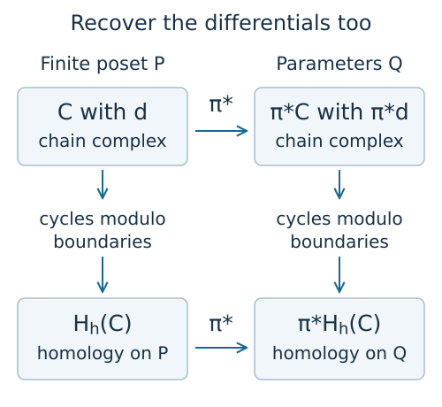

# Why finite computations stay tame

In the [tameness chapter](tameness.md), a module with a line at every
parameter failed to admit a finite encoding because its maps kept changing.
That example gives us a reason to ask where the finiteness comes from in
the constructions we actually use. For a filtration of a fixed finite
complex, we can read the answer from the complex itself. For our square,
we already have an explicit encoding.

We can then follow what happens when we calculate with those finite data.
If a map between modules is encoded along with its source and target, its
kernel and image can be computed on the same finite poset. The same
reasoning applies to quotients and homology. Working through this mechanism
will explain how Ezra Miller's framework supports a sequence of algebraic
calculations without a new finiteness argument at every step.

After a small calculation on the square, we will see how this leads to
closure results for **abelian categories**, where these algebraic
operations remain within the chosen class of objects and maps. We need
spaces, structure maps, and
[recovery by pullback](finite_encodings.md#what-the-definition-requires).
The preceding chapter supplies the full equivalence theorem; here, remember
that “tame” means admitting a finite encoding with finite-dimensional spaces.
No Julia session or prior category theory is required.

## A finite filtration supplies its own encoding

Let $K$ be a finite simplicial or cubical complex, and suppose each parameter
$q$ in a poset $Q$ selects a subcomplex $K_q$, with
$K_q\subseteq K_r$ whenever $q\leq r$. Take $P$ to be the finite poset of
all subcomplexes of $K$, ordered by inclusion. Then

$$
\pi:Q\longrightarrow P,\qquad \pi(q)=K_q
$$

is order-preserving. Fix a field $\mathbb{k}$ and a homological degree $h$.
On $P$, assign $N(L)=H_h(L;\mathbb{k})$ and the maps induced by inclusions.
These spaces are finite-dimensional. The persistence module of the
filtration is exactly $\pi^*N$, including its maps. This is the observation
in [Ezra Miller's Remark 1.4](https://arxiv.org/html/2008.00063#S1.SS3).

For the ring lesson, the selected shapes are empty before grade $0$, the
ring from $0$ to just below $5$, and the filled square from $5$ onward.
Those three states already give an encoding; their first homology is
$0,\mathbb{F}_2,0$. The two-parameter variant still selects subcomplexes
of the same finite collection of cells, so the argument still applies.

We used every subcomplex to make the existence argument transparent. An
encoder can often use far fewer labels, since many of those subcomplexes
never appear in the filtration. This mathematical argument also applies
when we compute ordinary persistence directly, without constructing a
TamerOp `EncodingResult`.

## Follow one map on the square

Return to $M=\mathbb{k}[[0,2]^2]$, our square module, now with
$\mathbb{k}=\mathbb{Q}$. Take two copies and add their vectors:

$$
f:M\oplus M\longrightarrow M,\qquad f_q(a,b)=a+b
\quad\text{for }q\in[0,2]^2.
$$

Outside the square, $f_q$ is the unique map $0\to0$. Inside, its matrix is
$[\,1\ \ 1\,]$. These component maps commute with the structure maps:
interior comparisons use identities, and comparisons entering or leaving
the support give zero on both routes. Thus $f$ is a **module morphism**,
a compatible family of linear maps between two modules.

Inside the square, a pair maps to zero precisely when $a+b=0$. We can
therefore write every such pair as $a(1,-1)$, giving the kernel line in
the following table.

| Operation on $f_q$ | Inside the square | Outside |
| --- | --- | --- |
| Kernel: vectors sent to zero | $\operatorname{span}\{(1,-1)\}$ | $0$ |
| Image: vectors reached in the target | $\mathbb{k}$ | $0$ |
| Cokernel: target modulo the image | $0$ | $0$ |

We can follow that line through the parameter plane. A comparison inside
the square carries $(1,-1)$ to itself, while a comparison leaving the
square sends it to zero. These are exactly the maps of $M$, under the
identification $a\mapsto a(1,-1)$, so $\ker f\cong M$ as a module.
The image has the same support and identity maps, giving
$\operatorname{im}f\cong M$, and the cokernel is zero everywhere.

Either of the square's earlier encodings can carry this calculation. At
the label representing the square, use the matrix $[\,1\ \ 1\,]$; at
the labels carrying zero spaces, use the empty matrix. Taking its kernel,
image and cokernel at those labels gives the answers we just followed on
the whole parameter plane.

## Why the finite calculation recovers the original one

Suppose $A$ and $B$ are modules on a finite poset $P$, and
$g:A\to B$ is a module morphism on that same poset. For an order-preserving
map $\pi:Q\to P$, the pulled-back morphism has component
$(\pi^*g)_q=g_{\pi(q)}$. Consequently,

$$
\ker(\pi^*g)\cong\pi^*(\ker g),\qquad
\operatorname{coker}(\pi^*g)\cong\pi^*(\operatorname{coker}g).
$$

Both sides take the kernel or quotient of the same matrix at each parameter.
Their structure maps are the same restrictions or induced quotient maps.
Images work the same way. This property is called **exactness of pullback**.
It explains why we can do these operations on the finite model and recover
the answer on the original domain.

For homology, let $C_\bullet$ be a chain complex on $P$ whose terms
have finite-dimensional stalks. It consists of modules $C_h$ with
boundary morphisms $d_h:C_h\to C_{h-1}$ satisfying $d_h d_{h+1}=0$.
Its cycles are $\ker d_h$, its boundaries are $\operatorname{im}d_{h+1}$,
and its homology is their quotient. Thus

$$
H_h(\pi^*C_\bullet)\cong\pi^*H_h(C_\bullet).
$$

*This schematic follows the calculation. Horizontal arrows mean
pullback along the same classifier $\pi$. Vertical arrows mean taking
cycles and boundaries, then their quotient. The differential maps belong
to the encoded data, which is why both routes recover the same answer.*

At any fixed degree, the terms at each of the finitely many labels are
finite dimensional, so their homology is too. Pullback then recovers the
homology module throughout $Q$. The finite description has survived the
calculation for the same reason that the kernel line survived our addition
map on the square.

## The role of abelian categories

A **category** specifies objects and the maps between them, together with
identity maps and composition. Here the objects are modules and the maps
are module morphisms. In an **abelian category**, maps can be added,
finite direct sums and kernels and cokernels exist within the category,
and the quotient of a source by its kernel agrees with the image in its
target. These properties make the usual construction of homology
available. Modules of finite-dimensional vector spaces on a fixed finite
poset have this property: perform the operations at each label, and the
induced maps fit together as we have just seen.

There is a distinction when starting with modules on an infinite domain.
Encoding two objects need not encode every morphism between them. Ezra
Miller obtains an abelian category by requiring **tame morphisms** too:
their components are constant under compatible identifications on a common
finite subdivision. See
[Definition 4.27 and Proposition 4.31](https://arxiv.org/html/2008.00063#S4.SS5).

Our addition map on the square meets this requirement: its matrix is
constant on the support and zero outside. A complex supplied over a finite
poset already retains its differential matrices on that same base. This
is why the homology argument needed the differentials along with the
terms; tameness of the terms alone would leave out the maps whose kernels
and images we take.

### When all morphisms are covered

Lukas Waas obtains a stronger conclusion through **connective encoding
structures**, whose
[closure conditions on sets](https://arxiv.org/html/2407.08666v1#S2.SS2) govern
the allowed fibers. Each allowed order-convex set must have finitely many
components connected by zigzags of comparable points, also allowed.
Order-convex means containing every point between comparable endpoints.
His [Theorem 3.4 and Proposition 3.5](https://arxiv.org/html/2407.08666v1#S3)
give a full abelian subcategory. Any finite family of modules in that class
admits a common finite encoding with fully faithful, exact pullback. “Full” includes every
ambient module morphism between its objects; “fully faithful” means those
morphisms correspond bijectively to maps on this finite model.

On $\mathbb{R}^n$, [Theorem 1.1](https://arxiv.org/html/2407.08666v1#S1)
covers fibers formed by finite Boolean combinations of topologically closed
piecewise linear upsets, or closed semialgebraic upsets. Piecewise linear
sets are built from finitely many polyhedral pieces; semialgebraic sets
are specified by finite Boolean combinations of polynomial equations and
inequalities. Here Boolean combinations mean finite unions,
intersections and complements. These are sufficient hypotheses;
arbitrary piecewise linear fibers do not suffice, as
[Example 3.1](https://arxiv.org/html/2407.08666v1#S3) demonstrates.

A particularly useful class allows finite unions of axis-aligned boxes,
including open or closed endpoints and unbounded intervals. Modules encoded
with these fibers form a full abelian subcategory; see Barbara Giunti,
John S. Nolan, Nina Otter, and Lukas Waas,
[Example 3.8, Remark 3.20, and Corollary 3.23](https://arxiv.org/html/2107.09036v5#S3).
Our closed square belongs to this class: its encoding by nine regions uses
products of the bands $(-\infty,0)$, $[0,2]$, and $(2,\infty)$.
Consequently the closure statement covers every morphism between modules
in this class of modules encoded by boxes, beyond the particular addition map we checked.

Endpoint conventions remain part of these statements. The general
theorem based on closed upsets and the box class just described are different choices
of allowed geometry. We use the latter for the square, preserving its
closed upper boundary.

Within one of these classes, we can establish the finiteness argument
once and then use its closure under the allowed operations. The
hypotheses tell us which objects and maps are covered. In particular,
the existence of a suitable common encoding does not say that every
encoding we happen to have chosen already represents all ambient maps.

## What the construction settles for a TamerOp user

The relevant starting point determines where the guarantee comes from.

| Starting point | Reason finiteness is already available |
| --- | --- |
| A finite poset module with validated spaces and maps | It is already the finite object on which the linear algebra operates. |
| A supported finite fringe presentation, such as the square | The regions and coefficients specify a tame module; the encoder constructs its finite representation under its geometry contracts. |
| A filtration by subcomplexes of one fixed finite complex | The subcomplex argument gives a finite encoding of its homology module. |
| A module morphism or complex retained on a common finite base | Kernels, images, quotients, and homology pull back to the corresponding operations on the represented objects. |

The package's [construction and geometry contracts](tameness.md#from-an-existence-theorem-to-an-implemented-construction)
still determine which inputs it can process. Waas's general refinement
theorem is not a claim that TamerOp accepts arbitrary symbolic regions or
constructs a fully faithful common encoding for every such input.

There is also a separate modeling question. A finite image, a truncated
complex, or a chosen grid defines the module being computed. Its tameness
does not prove that it equals the persistence of an underlying continuous
space. Establishing that comparison may need an exactness or approximation
result for the particular model. Similarly, a finitely written program can
specify the [infinitely changing module](tameness.md#a-short-rule-and-a-finite-window-are-different-claims)
from the previous chapter. Computability alone is insufficient.

The meaning of “tame” also matters when reading the literature. The work
of Ulrich Bauer, Cameron Gusel, and Luis Scoccola describes broad
applicability of **q-tameness**, while explicitly distinguishing it from
Ezra Miller's stronger finiteness condition; see its
[motivation and context](https://arxiv.org/html/2603.12049v1#S1.SS1).
The previous chapter's [q-tame counterexample](tameness.md#distinguish-this-from-q-tameness)
already shows why that broader condition does not supply a finite encoding.

## Which category does the calculation use?

The operations above use kernels and quotients of maps that we have
already retained. Derived operations such as Ext and Tor introduce a
further choice: they use resolutions, whose terms must have appropriate
properties in the category where we compute. Pulling a resolution back
keeps it exact, but need not preserve those properties.

The [categories and comparison chapter](math_categories.md) explains
this distinction through a small finite example. It will let us identify
what an algebraic computation on a chosen encoding establishes, and what
we need before comparing it with a computation on another poset.
