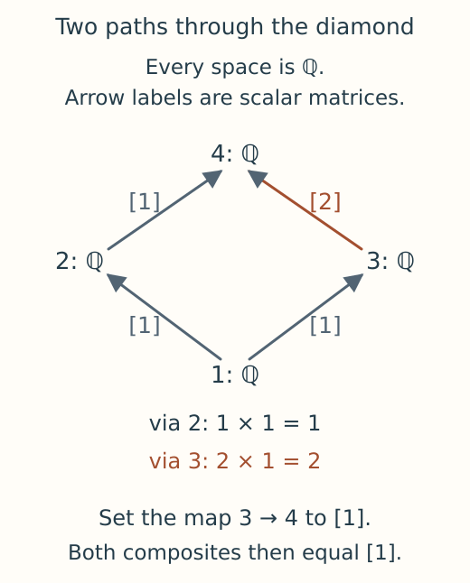

# Build and validate a small module from spaces and maps

Suppose four vector spaces form a diamond, with $1<2<4$ and $1<3<4$.
We want their maps to define a module on this finite poset, so following either
path from 1 to 4 must give the same linear map. This recipe enters four
one dimensional rational spaces, finds a disagreement between the paths, and
repairs the map that causes it.



*All four spaces are copies of the rational field. The arrows give the maps
between adjacent labels. Starting with the scalar 1 at the bottom, the two
routes currently give 1 and 2 at the top, so these data cannot yet define a
module.*

The input is already on a finite poset; we do not infer a filtration or an
assignment from ambient parameters. The guide to
[constructing modules without a filtration](../tutorials/presentations.ipynb)
explores those other starting points.

```julia
import TamerOp as OP
A = OP.Advanced
order = Bool[1 1 1 1; 0 1 0 1; 0 0 1 1; 0 0 0 1]
editor = OP.module_editor(; order, dimensions=ones(Int, 4),
    maps=Dict((1,2)=>[1;;], (1,3)=>[1;;], (2,4)=>[1;;], (3,4)=>[2;;]))
report = A.check_module_editor(editor)
@assert !report.valid
@assert report.witness.first_composite == [1;;]
@assert report.witness.second_composite == [2;;]
```

The order matrix records every comparison, including identities and
$1\leq4$. The coefficient dictionary supplies only **cover maps**, meaning
maps between comparable labels with no intervening label. Each matrix has
one row per target coordinate and one column per source coordinate. Here the
spaces each have dimension one, so the matrices are single coefficients.

The report shows why the draft fails: the two composites from 1 to 4 are
$[1]$ and $[2]$. The editor keeps the draft so we can inspect and correct it,
but `editor_object` will refuse to construct a module until the maps agree.
Replace the map from 3 to 4 and check the resulting composite:

```julia
OP.edit_module!(editor; map=((3,4), [1;;]))
A.check_module_editor(editor; throw=true)
M = OP.editor_object(editor)
@assert A.structure_map(M; source=1, target=4) == [1;;]
```

Both paths now carry a scalar to itself. `M` is a `PModule`, the finite poset
together with its spaces and compatible maps, ready for dimension queries,
ranks and module algebra. It owns its data, so later edits to the draft leave
this module unchanged. The
[editor contract](../src/reference/visual_sessions.md#author-a-finite-module-or-presentation)
explains field changes, undo and input limits.

For a computed static view, load CairoMakie and display
`OP.visualize(A.inspection_snapshot(editor))`. With WGLMakie loaded,
`OP.visualize(editor; backend=:wglmakie)` opens the live table editor, which
needs Julia to remain running. The
[guide](../tutorials/presentations.ipynb) follows that workflow and constructs
a module from an indicator presentation as another example.
