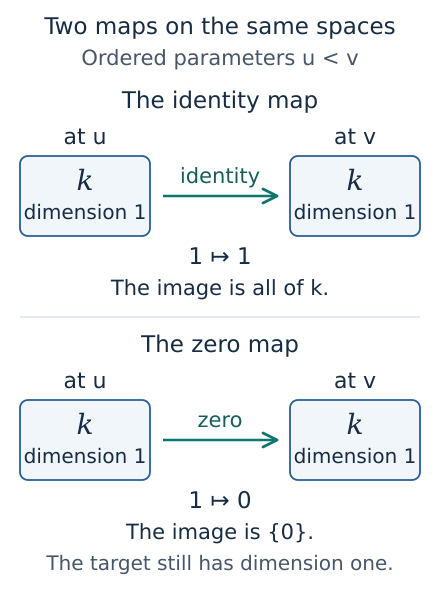

# Why two parameters change the problem

In the [ring lesson](tutorials/ring.ipynb), we could watch the shape grow by
increasing a single number. Its hole appeared at zero and filled in at five,
giving the interval $[0,5)$. Suppose now that we want to choose squares using
two measurements, each with its own threshold. We can still follow what
happens as the shape grows, though we first need to understand which changes
of threshold make it grow.

The ring example, together with some familiarity with vectors and linear
maps, gives us enough to work this out on paper. Along the way we will see
why counting holes leaves part of the story unresolved, and how linear maps
keep the information we need. The [chapter on persistence modules](persistence_modules.md)
develops the definitions and arguments further; no Julia session is needed here.

## From one threshold to two

Give each square two values, $f$ and $g$, and choose thresholds $a$ and $b$.
Include a square when both $f\leq a$ and $g\leq b$, together with its edges
and vertices, and write $X_{(a,b)}$ for the resulting shape. If we increase
either threshold while holding the other fixed, every square already
included still meets both conditions. The shape can therefore gain squares
without losing any. This suggests the comparison

$$
(a,b)\leq(a',b')\quad\text{means}\quad a\leq a'\text{ and }b\leq b',
$$

called **coordinatewise order**: we compare each threshold with its
counterpart, requiring neither to decrease. It guarantees the inclusion
$X_{(a,b)}\subseteq X_{(a',b')}$. We are imagining a second measurement here;
the earlier ring computation supplied only one, so constructing this new
family would require choosing that additional measurement.

The direction of each comparison comes from the rule for including squares.
If a measurement retains cells above a threshold, raising that threshold
removes cells. In that case we reverse the order on that coordinate, or
negate the threshold, so that increasing the coordinates used here continues
to mean enlarging the shape.

## Which choices can we compare?

We can see what this order allows by choosing four pairs of thresholds.
Each point in the picture selects an entire shape through its two threshold
values; the axes describe these choices rather than locations within the shape.

*Moving right or up increases a threshold, so the shape selected at the tail
of an arrow is contained in the one at its head. We also have $p\leq s$
through either route. These four sample points illustrate the order on the
parameter plane; they do not yet give a finite encoding.*

For example, moving from $p$ to $q$ raises the second threshold and keeps
the first fixed, so $p\leq q$. The same reasoning gives $r\leq s$. Moving
from $q=(1/4,3/2)$ to $r=(3/2,1/4)$ is different: the first threshold
increases while the second decreases. Neither $q\leq r$ nor $r\leq q$
holds, and we call the pair **incomparable**. A partially ordered set, or
**poset**, records comparisons of this kind while allowing some pairs to
be incomparable. Sorting the four points into a list would not supply the
comparisons needed for a prescribed sequence of inclusions.

## How classes continue between parameters

To follow the holes, fix a coefficient field $\mathbb{k}$, which supplies
the scalars for our vector spaces and linear maps. The ring lesson used
$\mathbb{F}_2$, the field with two elements. At a parameter $u$, write
$M(u)$ for the vector space of hole classes. A class records a linear
combination of loops, with combinations identified when their difference
bounds a combination of filled cells. For comparable parameters $u\leq v$,
the inclusion of shapes induces a linear map $M(u)\to M(v)$. This
**structure map** tells us what
becomes of each class in the larger shape. A loop may bound a filled region
there, sending its class to zero even though it was nonzero in the earlier
shape. The map can therefore send distinct classes to the same class.

This helps explain why a zero map and a missing comparison mean different
things. A zero structure map says that every class from the earlier
parameter becomes zero at the later one. Between the incomparable $q$ and
$r$ in our picture, the order prescribes no structure map at all.

We can isolate the information carried by a map in a small example. Take
two ordered parameters $u<v$ and put a vector space of dimension one at
each. There are already two possibilities:

$$
\mathbb{k}\xrightarrow{[1]}\mathbb{k}
\qquad\text{and}\qquad
\mathbb{k}\xrightarrow{[0]}\mathbb{k}.
$$

Here we view the field $\mathbb{k}$ as a vector space over itself. The
matrix $[1]$ gives the identity map, which sends each scalar to itself;
$[0]$ gives the zero map, which sends every scalar to zero. Their
**images**, the sets of vectors reached in the target, show the difference.

*The spaces have the same dimensions in both examples. Under the identity
map every target vector is reached from the source. Under the zero map the
image is just zero, even though the target still contains nonzero vectors.
The boxes denote vector spaces; this is a schematic, not a picture of the
underlying shapes.*

A dimension plot therefore gives the same answer for these two examples,
while their maps tell us different things about continuation. We needed
only two ordered parameters to see this, so the loss of information already
occurs with one parameter. The ring's barcode retains the continuation
information that the dimensions alone omit.

Returning to the four points in the parameter plane, we can follow a class
from $p$ to $s$ through either $q$ or $r$. Both routes come from the same
inclusion of shapes, so composing their maps must give the same answer.
Staying at one parameter leaves its vectors unchanged. A collection of
spaces and maps satisfying these rules is a **persistence module**, and
the space at an individual parameter is often called its **stalk**. The
[full definition](persistence_modules.md#the-spaces-and-maps-must-fit-together)
makes the compatibility rules precise. For general modules with two
parameters, an ordinary barcode cannot provide a complete classification.
Keeping the spaces and their maps gives us an object we can continue to
investigate even when that familiar description is unavailable.

## Can infinitely many spaces and maps have a finite description?

There is now a practical question: how can we work with a space at every
point of the real parameter plane, and a map for every comparison? For our
fixed finite collection of squares, the shapes change only when a threshold
passes one of the finitely many assigned values. Between those changes,
the same cells and inclusions recur. This gives us a reason to look for a
finite description that recovers both the spaces and their maps.

A **finite encoding** supplies such a description through a finite poset
of labels, a vector space at each label and compatible maps between
comparable labels. An assignment of the original parameters to those labels
must respect their order so that we can recover the maps as well as the
spaces. Our construction from finitely many cells supplies the needed
finiteness; an arbitrary persistence module need not admit this description.

The [finite encodings chapter](finite_encodings.md) works out the recovery
in a module supported on the closed square $[0,2]^2$ over rational
coefficients. This is a new module specified directly, with answers we can
check by hand. Both incomparable parameters from our picture lie inside
its support, so it will also let us see how nonzero spaces can occur at
parameters with no prescribed map between them.

For a fuller account of the spaces and compatibility rules before continuing,
read [persistence modules](persistence_modules.md). It leads to the same
square example.
